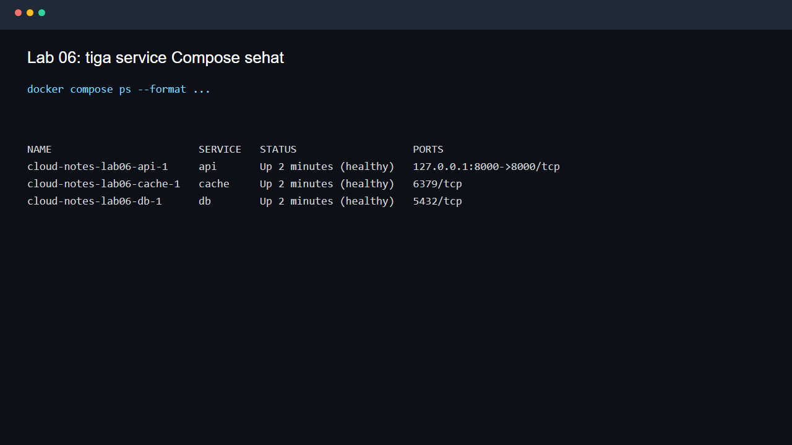
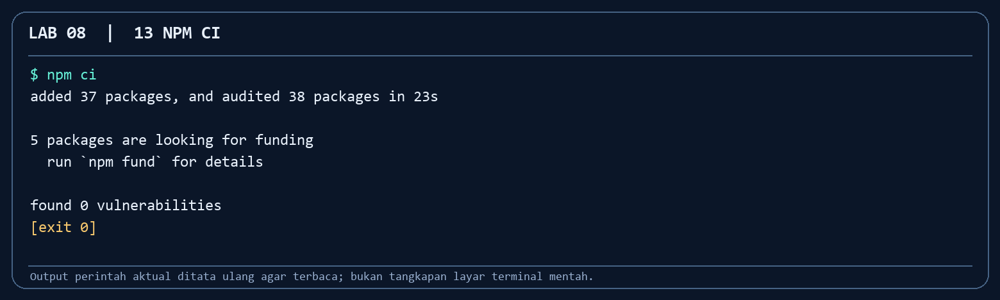
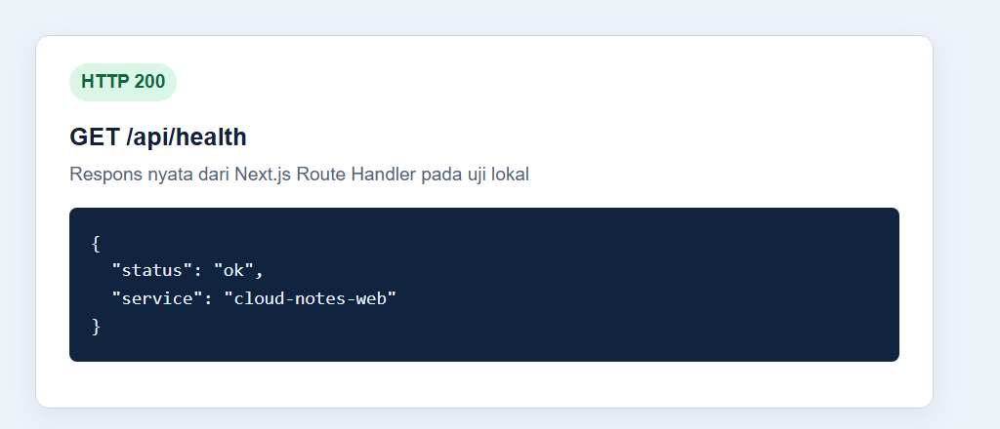
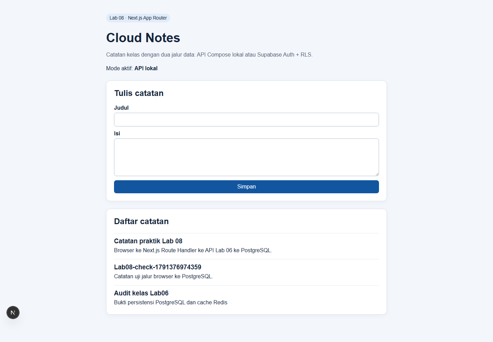
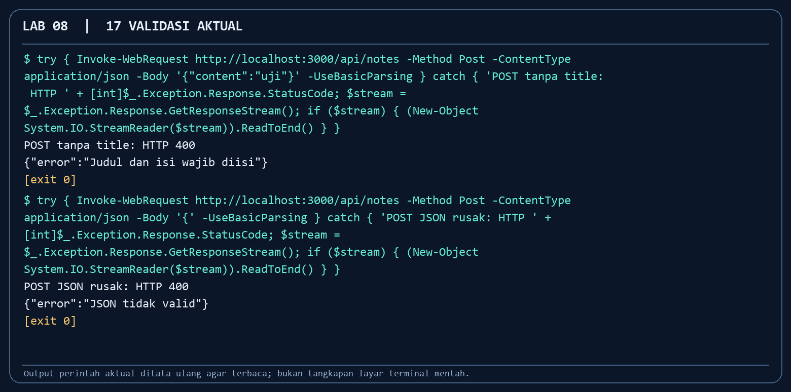
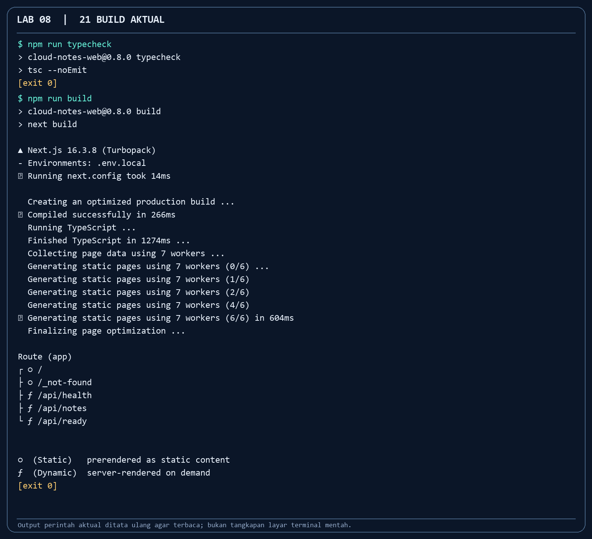
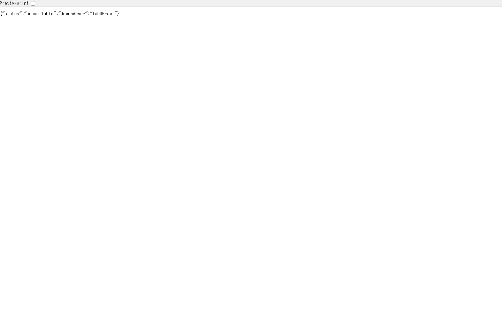

# Lab 08 — Next.js, Route Handler, dan Cloud Notes

**Kebijakan kelas:** Lab ini latihan formatif, tanpa tugas, nilai, atau penyerahan terpisah. Satu proyek besar dikerjakan oleh kelompok **3 orang**, dengan presentasi checkpoint minggu 7 (UTS) dan hasil akhir minggu 14 (UAS). Simpan hasil lab hanya bila berguna sebagai referensi atau bukti proses proyek. Baca [brief proyek kelompok](PROYEK_KELOMPOK.md). Bobot resmi tetap mengikuti RPS/LMS.

**Subtopik:** inisialisasi Next.js dengan TypeScript, Tailwind dan App Router, halaman serta komponen dan layout, GET/POST Route Handler, mode Supabase Auth dan RLS melalui environment variables, serta deployment dari Git ke Vercel. Docker Desktop di laptop adalah jalur utama untuk stack Cloud Notes. GitHub Codespaces menyediakan jalur yang sama dari browser. Monitoring membantu melihat dampak penyimpanan pada jalur API lokal.

## App Router dari proyek kosong

1. Di folder latihan terpisah, buat starter dengan `npx create-next-app@16.4.6 lab08-next-starter --ts --tailwind --app --src-dir --use-npm --no-linter --no-cache-components --disable-git --yes`. Masuk ke `lab08-next-starter`, lalu jalankan `npm run dev -- --hostname 0.0.0.0 --port 3010`. Buka port **3010** dari browser, dengan visibilitas **Private** pada Codespaces.
2. Edit `src/app/page.tsx` sesuai contoh README. Ganti teks judul dan satu kelas warna Tailwind, lalu lihat hasilnya di browser. `src/app/layout.tsx` memberi struktur yang dipakai semua halaman.
3. Kembali ke Cloud Notes. Bandingkan layout global dan `src/app/ai/layout.tsx`. Periksa komponen `PageHeading` di beranda dan halaman Tanya AI serta `NoteCard` pada setiap catatan. Cocokkan props TypeScript dengan nilai yang terlihat.
4. Buka handler `src/app/api/notes/route.ts`. Kirim POST memakai terminal, baca status 201, lalu ambil daftar lewat GET dan lihat status 200. [Langkah lengkap, kode, dan uji Route Handler](README.md#latihan-nextjs-dari-nol)

## Praktik utama dengan Docker

1. Di laptop Windows, buka Docker Desktop, unduh atau clone branch `lab08-docker-codespaces`, lalu buka PowerShell pada folder yang memuat `compose.yaml`. Di Codespaces, masuk ke GitHub dan buka branch kelas, pilih **Code → Codespaces → Create codespace on lab08-docker-codespaces**, lalu tunggu proses awal selesai. [Jalur Docker Desktop](README.md#a-docker-di-laptop) · [Jalur Codespaces](README.md#b-github-codespaces)
2. Jalankan `docker compose up -d --build --wait`, lalu `docker compose ps`. Cari empat service **healthy**. Di laptop buka `http://127.0.0.1:3000`. Di Codespaces pilih **Ports → Cloud Notes (3000) → Open in Browser** dan pertahankan port **Private**. Halaman awal membaca **Mode aktif: API lokal**.
3. Simpan satu catatan dan refresh. Buka `/api/health` dan `/api/ready` pada host Cloud Notes. Keduanya harus berstatus 200 saat stack sehat. Di terminal jalankan `docker compose exec -T web npm run check:local` dan cari `12 PASS, 0 FAIL`. [Latihan inti dan pemeriksaan web](README.md#latihan-inti-untuk-kedua-jalur)
4. Gunakan `docker compose --profile monitoring up -d --build --wait` untuk menambahkan Prometheus dan Grafana. Simpan satu catatan baru, amati counter, lalu tulis rule satu menit dan panel sendiri bila waktu memungkinkan. [Monitoring dan panel Grafana dari nol](README.md#monitoring-cloud-notes)
5. Siapkan Supabase latihan, aktifkan mode cloud lewat file `.env`, lalu simpan dan periksa catatan di Table Editor. [Integrasi Supabase dan bukti data](#tambahan-b-supabase-dan-vercel)
6. Setelah latihan selesai, jalankan `docker compose --profile monitoring down`. Di Codespaces, lanjutkan dengan **Stop codespace**. `down` mempertahankan volume. Berkas `.env` tetap di salinan kerjamu. [Penutupan latihan](README.md#selesai-latihan)

## Jalur pengayaan dengan Node.js

Bagian 1–8 memakai tiga terminal di Windows untuk memperlihatkan hubungan antar repo secara manual. Mahasiswa yang memakai Docker dapat langsung membuka bagian B ketika praktik utama selesai.

## 1. Siapkan tiga terminal

Siapkan Docker Desktop yang Engine-nya berjalan, Git, serta Node **22 atau lebih baru**. Versi tersebut memenuhi dependensi Next.js dan Supabase pada lockfile proyek. Dua repo harus berada pada **komputer yang sama**.

| Terminal | Folder kerja | Fungsi |
|---|---|---|
| 1 | `meet6CloudService-local` | Menjalankan backend Compose dan memeriksa service |
| 2 | `meet8CloudService-local` | Menjalankan server Next.js dan melihat log |
| 3 | `meet8CloudService-local` | Mengirim request serta menjalankan pemeriksaan |

Buka **terminal 1** di folder tempat menyimpan proyek:

```powershell
git clone https://github.com/SeedFlora/meet6CloudService.git meet6CloudService-local
Set-Location .\meet6CloudService-local
Copy-Item .\.env.example .\.env
docker compose up --build -d --wait
docker compose ps
curl.exe -i http://127.0.0.1:18006/health
```

`--wait` menunggu API, database, dan cache sehat. Hasil terakhir harus **HTTP 200**, dengan JSON status ok, database postgres, cache redis. Backend yang sudah sehat dari Lab 06 boleh digunakan langsung: buka terminal di clone itu dan pertahankan `.env` serta volume yang sudah ada. Seluruh URL backend pada revisi ini memakai **18006**.



*Screenshot acuan berasal dari versi lama yang memakai port 8000. Gunakan 18006 pada perintah sekarang. Yang dibaca dari gambar ialah tiga service healthy, bukan angka port lama. Gambar dalam repo merupakan acuan uji terdahulu, bukan bukti mesin Anda.*

## 2. Jalankan frontend

Buka **terminal 2** di folder induk yang sama seperti awal terminal 1:

```powershell
git clone https://github.com/SeedFlora/meet8CloudService.git meet8CloudService-local
Set-Location .\meet8CloudService-local
Get-Location
node --version
npm --version
npm ci
Copy-Item .\.env.example .\.env.local
npm run dev
```

`Get-Location` harus berakhir dengan `meet8CloudService-local`. `node --version` harus menunjukkan 22 atau lebih baru, lalu `npm ci` memasang versi paket dari lockfile. `.env.local` mengatur `LOCAL_API_URL=http://127.0.0.1:18006`; dua variabel Supabase kosong agar mode lokal aktif. Pada clone lama, periksa konfigurasi yang sudah ada dan pertahankan nilai pribadi. File `.env.local` diabaikan Git.

`npm run dev` menjalankan proses terus-menerus. Biarkan terminal ini terbuka. Semua perintah pemeriksaan berikut memakai **terminal 3**, dibuka pada folder `meet8CloudService-local`.



*Hasil yang dibaca: instalasi selesai tanpa error. Jumlah paket dan pesan audit dapat berbeda. [Output acuan](screenshots/13_npm_ci.txt).*

Buka <http://localhost:3000> di Chrome. Label harus menunjukkan **Mode aktif: API lokal**. Jalankan di terminal 3:

```powershell
curl.exe -i http://localhost:3000/api/health
curl.exe -i http://localhost:3000/api/ready
```

Keduanya harus HTTP 200. `/api/health` menyatakan Next.js hidup. `/api/ready` juga memeriksa health API Lab 06; health frontend saja belum membuktikan database siap.



*Acuan respons health: HTTP 200. Status backend diperiksa melalui ready, bukan endpoint health ini.*

## 3. Simpan catatan dari browser

1. Pada form **Tulis catatan**, isi judul `Catatan kelas Next.js` dan isi `Browser memakai Route Handler server`.
2. Klik **Simpan** dan tunggu catatan muncul pada daftar.
3. Buka <http://127.0.0.1:18006/notes> di tab lain. Cari judul yang sama.
4. Di terminal 2, cari baris log JSON `notes_proxy`: log memuat status, `requestId`, dan durasi tanpa isi catatan.



*Hasil yang diharapkan: judul dan isi baru terlihat pada daftar. Data berasal dari PostgreSQL melalui API Lab 06. Ambil screenshot hasil laptop sendiri bila berguna untuk proyek kelompok.*

Alirannya: browser mengirim `/api/notes`, Route Handler Next.js memvalidasi request, API Lab 06 menyimpan ke PostgreSQL, lalu frontend membaca daftar terbaru. Redis dipakai oleh API Lab 06; browser tidak mengakses database atau jaringan Compose langsung.

## 4. Uji GET, POST, dan input salah

Gunakan terminal 3. Untuk POST, kirim JSON lewat input standar agar tanda kutip tetap utuh pada Windows PowerShell:

```powershell
'{"title":"Uji Route Handler","content":"POST dari PowerShell"}' | curl.exe -i http://localhost:3000/api/notes -H 'Content-Type: application/json' --data-binary '@-'
curl.exe -i http://localhost:3000/api/notes
```

POST harus menghasilkan **HTTP 201** dan catatan dengan ID. GET harus **HTTP 200** serta daftar yang memuat judul itu. Respons membawa header `X-Request-ID`; cocokkan nilainya dengan `requestId` pada log terminal 2 untuk menelusuri request.

Sekarang kirim body tanpa judul:

```powershell
'{"content":"tanpa judul"}' | curl.exe -i http://localhost:3000/api/notes -H 'Content-Type: application/json' --data-binary '@-'
```

Hasil yang benar adalah **HTTP 400** dengan pesan bahwa judul dan isi harus terisi. Input ini ditolak sebelum diteruskan ke backend. `curl.exe -i` tetap menampilkan status dan body error, sehingga tidak perlu `try/catch` PowerShell.



*Acuan: request tanpa judul dan JSON rusak menghasilkan HTTP 400. ID, timestamp, serta rincian tampilan terminal dapat berbeda. [Output acuan](screenshots/17_validasi_aktual.txt).*

## 5. Kenali source yang bekerja

Buka file berikut pada VS Code:

| File | Bagian yang dibaca | Fungsi |
|---|---|---|
| `src/app/page.tsx` | `'use client'`, state, form, `fetch('/api/notes')` | Interaksi dan tampilan browser |
| `src/app/api/notes/route.ts` | `GET`, `POST`, `LOCAL_API_URL` | Proxy serta validasi pada server Next.js |
| `src/app/api/health/route.ts` | Respons status ok | Liveness Next.js |
| `src/app/api/ready/route.ts` | Pemeriksaan `/health` API Lab 06 | Readiness dependensi |
| `src/lib/supabase.ts` | `NEXT_PUBLIC_SUPABASE_*` | Mengaktifkan mode Supabase pada bagian tambahan |

Untuk mencari baris pada PowerShell:

```powershell
Select-String -Path .\src\app\page.tsx, .\src\app\api\notes\route.ts -Pattern 'use client', 'fetch', 'LOCAL_API_URL', 'export async function'
```

`LOCAL_API_URL` hanya dibaca Route Handler server. Variabel `NEXT_PUBLIC_` masuk bundle browser ketika build; URL serta publishable key Supabase memang untuk klien dengan RLS, sedangkan service role/secret key harus tetap rahasia.

## 6. Typecheck, build, dan selesai

Di **terminal 2**, tekan `Ctrl+C` untuk menghentikan server dev. Setelah berhenti, jalankan dari folder Lab 08:

```powershell
npm run typecheck
npm run build
```

Typecheck harus selesai tanpa error TypeScript. Build harus exit code 0 dan menampilkan route aplikasi. Untuk membuka web lagi, jalankan `npm run dev` pada terminal 2.



*Baca hasil: typecheck dan build selesai tanpa error. [Output acuan terdahulu](screenshots/21_build_aktual.txt). Ini tidak menggantikan pemeriksaan source pada mesin Anda.*

Setelah frontend berhenti dan backend tidak dipakai lab lain, jalankan di **terminal 1**:

```powershell
docker compose down
```

Volume database tetap tersimpan. Laporan, screenshot pribadi, checker, dan push ke repo sendiri merupakan latihan tambahan.

## Pembahasan

| Pertanyaan | Jawaban |
|---|---|
| Mengapa halaman memakai `'use client'`? | State, form, dan event membutuhkan kode browser. |
| Mengapa proxy berada di Route Handler? | Koneksi ke API lokal serta validasi diproses server Next.js. |
| Apa beda HTTP 400 dan 503? | 400 berarti input salah. 503 berarti dependensi layanan tidak tersedia. |
| Apakah Edge sama dengan SSR/SSG/ISR? | Edge adalah pilihan runtime. SSR, SSG, dan ISR menjelaskan kapan halaman dibuat atau diperbarui. |
| Apakah daftar catatan aman menjadi halaman statis bersama? | Data privat per pengguna perlu konteks sesi dan pembatasan akses, bukan satu hasil statis bersama. |

## Tambahan A. Outage dan checker

Bagian ini mengubah status service latihan. Jalankan setelah catatan berhasil tersimpan.

1. Di terminal 1 jalankan `docker compose stop api`.
2. Di terminal 3 jalankan:

```powershell
curl.exe -i http://localhost:3000/api/health
curl.exe -i http://localhost:3000/api/ready
curl.exe -i http://localhost:3000/api/notes
```

Hasil yang diharapkan: **200, 503, 503**. Next.js masih hidup, tetapi backend tidak tersedia. Refresh browser untuk melihat pesan API lokal gagal.

3. Di terminal 1 pulihkan dengan `docker compose up -d --wait api`. Ulangi ready dan notes di terminal 3; keduanya kembali **200**, dan catatan lama tetap terlihat.
4. Dari terminal 3 jalankan `npm run check:local`. Checker membuat satu catatan berjudul `Lab08-check-...` dan menguji penulisan serta pembacaan. Target **12 PASS, 0 FAIL**. Cocokkan judul yang dibuat checker pada daftar catatan.



*Hasil outage yang diharapkan: ready 503. Screenshot acuan berasal dari pengujian terdahulu, bukan simulasi yang otomatis berjalan pada mesin Anda.*

## Tambahan B. Supabase dan Vercel

### B1. Integrasi Supabase pada Docker Desktop dan Codespaces

1. Pilih proyek latihan di [Dashboard Supabase](https://supabase.com/dashboard/projects). Cari tabel `public.notes` di **Table Editor**. Jika tabel belum ada, jalankan [`schema.sql` Lab 07](https://github.com/SeedFlora/meet7CloudService/blob/main/schema.sql) dari **SQL Editor**. Tabel memakai `id`, `user_id`, `title`, `content`, dan `created_at`. Periksa bahwa RLS aktif dan policy SELECT serta INSERT untuk akun yang masuk memakai kepemilikan melalui `auth.uid()`.
2. Ambil **Project URL** dan **Publishable key** pada bagian **Connect**. Masukkan kedua nilai proyek yang sama ke `.env`, satu folder dengan `compose.yaml`. Saat memakai jalur Node.js manual, isi `.env.local` dan mulai ulang `npm run dev`. [Panduan file konfigurasi dan contoh nilai](README.md#mode-supabase-di-docker-compose)
3. Untuk Docker dari stack yang sudah sehat, jalankan `docker compose config --quiet`, lalu `docker compose up -d --build --wait --no-deps web`. Jika semua service sebelumnya berhenti, pakai `docker compose up -d --build --wait`. Buka Cloud Notes pada port **3000** dan cari **Mode aktif: Supabase**.
4. Masuk dengan akun aplikasi yang sudah dikonfirmasi. Untuk membuat akun baru, daftarkan dulu alamat Cloud Notes yang lengkap pada **Authentication → URL Configuration → Redirect URLs**. Klik **Daftar**, konfirmasi email bila diminta, lalu buka lagi aplikasi melalui port **Private** di Codespaces. [URL autentikasi Supabase](https://supabase.com/docs/guides/auth/redirect-urls)
5. Simpan judul uji yang unik, misalnya `Bukti Supabase Lab 08 13.30`. Pada **Table Editor → public → notes**, filter `title` dan cocokkan `content` serta `user_id`. Untuk demonstrasi pembaruan, ubah isi baris uji ini melalui Table Editor, simpan, lalu refresh aplikasi. Jika memakai dua akun latihan, akun kedua hanya melihat baris miliknya melalui aplikasi.
6. Ambil screenshot yang memperlihatkan mode Supabase, catatan uji di browser, dan baris yang sama di Table Editor. Samarkan alamat email, kata sandi, maupun nilai kunci. Checker 12 uji, Prometheus, dan Grafana pada langkah awal mengamati jalur API lokal. Gunakan bukti baris di dashboard untuk jalur Supabase.

### B2. Pengayaan deploy di Vercel

1. Di Vercel pilih **Add New → Project**, lalu import repo milikmu yang memuat branch `lab08-docker-codespaces`. Gunakan framework **Next.js** dan root direktori **.**. File `.env` dan `.env.local` tetap di salinan kerja. Di **Settings → Environments → Production → Branch Tracking**, pilih `lab08-docker-codespaces`. [Panduan Git Lab 08](PANDUAN_GIT.md) · [Pelacakan branch produksi Vercel](https://vercel.com/docs/git#customizing-the-production-branch)
2. Agar pengaturan Supabase dikelola integrasi, kembali ke organisasi pemilik proyek latihan di Dashboard Supabase. Pilih **Integrations → Install Vercel integration** dan lanjutkan di Vercel. Di Supabase klik **Add new project connection**, lalu pilih proyek Supabase dari B1 dan proyek Vercel tadi. Vercel Marketplace dapat membuat proyek Supabase baru dengan tagihan melalui Vercel. [Hubungkan proyek yang sudah ada](https://supabase.com/docs/guides/integrations/vercel-preview-branches#connect-vercel) · [Vercel Marketplace](https://supabase.com/docs/guides/integrations/vercel-marketplace)
3. Pada proyek Vercel buka **Settings → Environment Variables**. Di **Production**, cek `NEXT_PUBLIC_SUPABASE_URL` dan satu kunci browser dari proyek latihan. Integrasi resmi dapat mengirim `NEXT_PUBLIC_SUPABASE_ANON_KEY`. Cloud Notes tetap berjalan dengan kunci `anon` ini. Jika kedua jenis tersedia, aplikasi mengutamakan `NEXT_PUBLIC_SUPABASE_PUBLISHABLE_KEY`. Tambahkan nilai publik yang kurang jika integrasi belum mengisi URL atau kunci browser. Pertahankan kunci server di pengaturan privat. **Preview** memakai cakupan sendiri dan dapat mendapat nilai per PR jika Supabase Branching juga dikonfigurasi. [Nama variabel resmi Supabase](https://supabase.com/docs/guides/integrations/vercel-preview-branches#after-you-connect)
4. Buka **Deployments**. Buat deployment dari branch `lab08-docker-codespaces` jika belum ada, atau gunakan **Redeploy** pada deployment Production dari branch itu. URL aplikasi yang siap harus menunjukkan **Mode aktif: Supabase**. [Perubahan environment dan redeploy](https://vercel.com/docs/environment-variables/managing-environment-variables)
5. Di Supabase buka **Authentication → URL Configuration → Redirect URLs**, lalu cek alamat HTTPS Vercel yang persis. Tambahkan jika belum ada. Masuk dengan akun aplikasi, simpan catatan berjudul `Bukti Vercel Lab 08`, dan cocokkan judul, isi, serta `user_id` di Table Editor. [Konfigurasi redirect Supabase](https://supabase.com/docs/guides/auth/redirect-urls) · [Langkah lengkap dengan jalur koneksi otomatis](README.md#hubungkan-supabase-yang-sudah-ada-ke-vercel)

## Kendala umum

| Gejala | Pemeriksaan |
|---|---|
| Node/EBADENGINE | Gunakan Node 22+, buka ulang terminal, periksa versi sebelum `npm ci`. |
| Port 3000 dipakai | Hentikan server Next.js lama atau lab lain yang memakai port ini. |
| Ready 503 | Periksa Lab 06 di 18006 dan `LOCAL_API_URL` pada `.env.local`; restart Next setelah perubahan. |
| `services.web.build.args must be a mapping` | Perbaiki format YAML pada Codespace yang sudah diedit atau buat Codespace baru dari branch kelas. Validasi dengan `docker compose config --quiet`. [Contoh blok yang benar](README.md#jika-codespace-lama-berhenti-pada-args-must-be-a-mapping) |
| Mode Supabase muncul saat ingin lokal | Kosongkan dua `NEXT_PUBLIC_SUPABASE_*` di `.env`, lalu bangun ulang `web`. Pada jalur Node manual, lakukan di `.env.local` dan mulai ulang server. |
| Mode API lokal muncul saat ingin Supabase | Cek nama `.env` di samping `compose.yaml`. Isi dua nilai proyek, lalu build ulang `web` dengan `--build`. |
| `npm ci` EPERM/ENOTEMPTY | Hentikan proses Next.js milik repo ini yang masih memakai `node_modules`, lalu ulangi instalasi. |
| Build gagal | Baca file/baris yang dilaporkan TypeScript; perbaiki sebelum mengulang build. |
