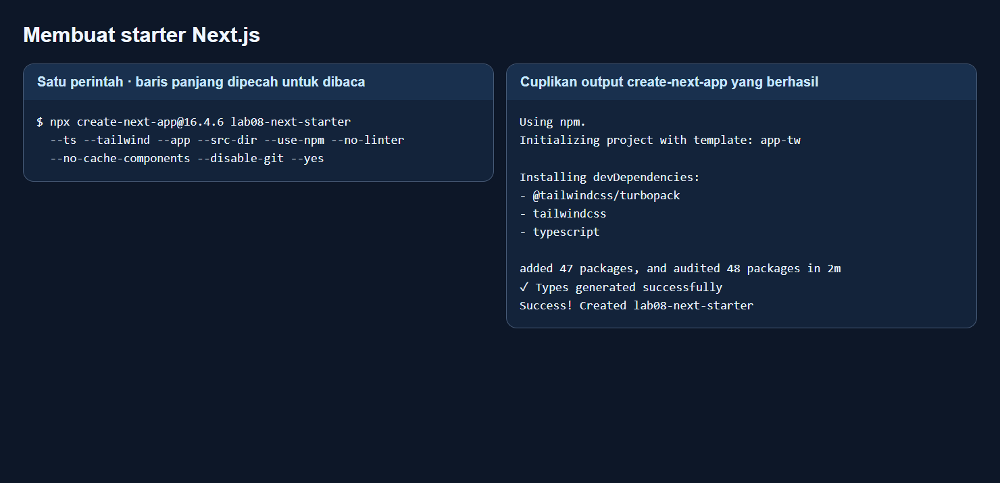
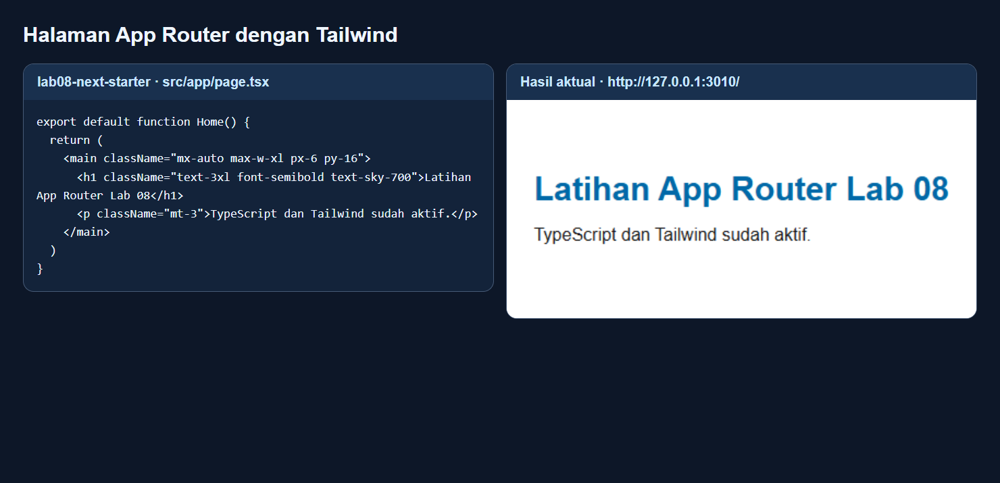
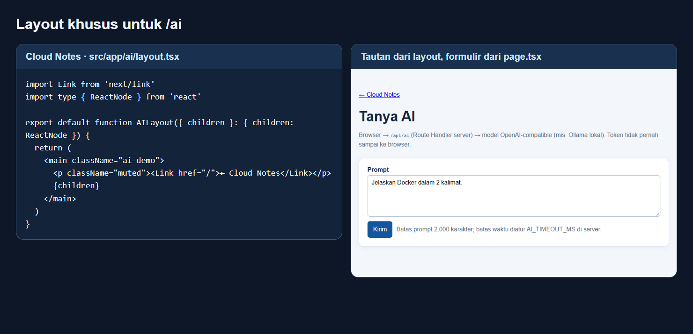
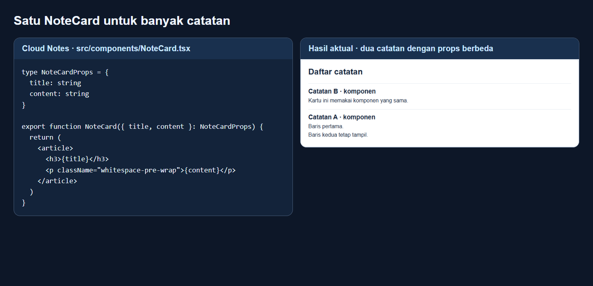
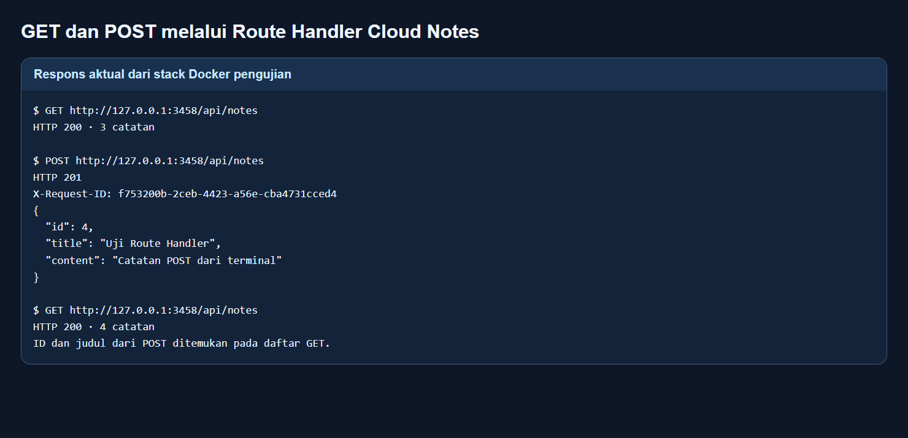
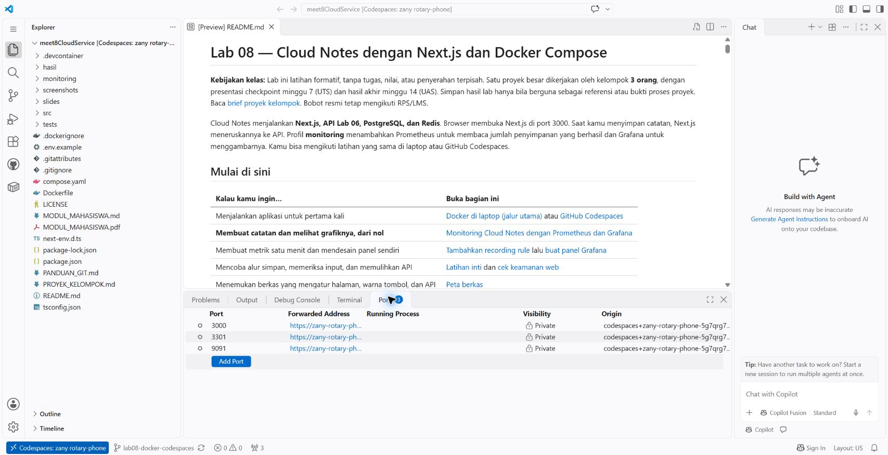
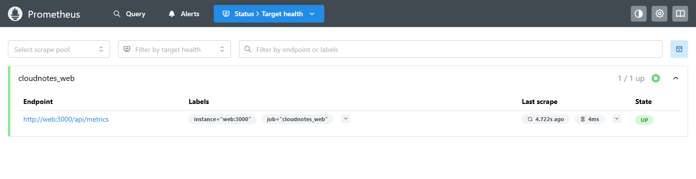
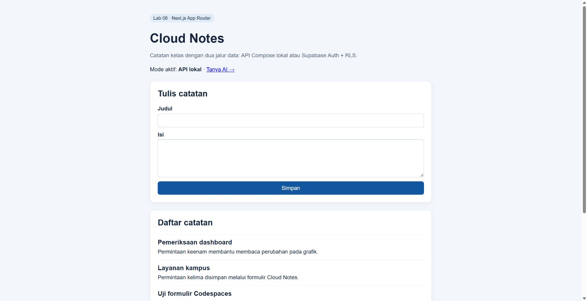
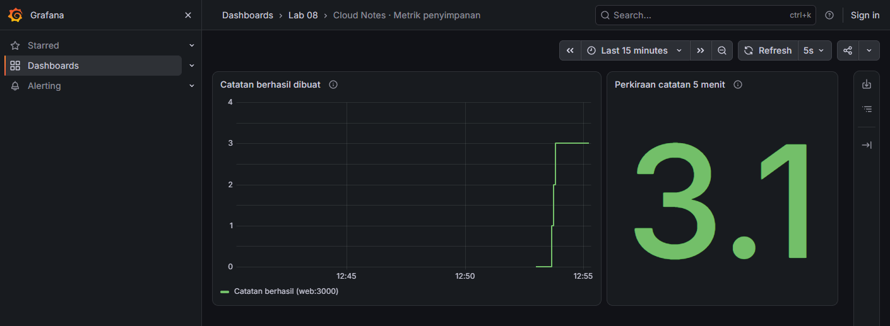
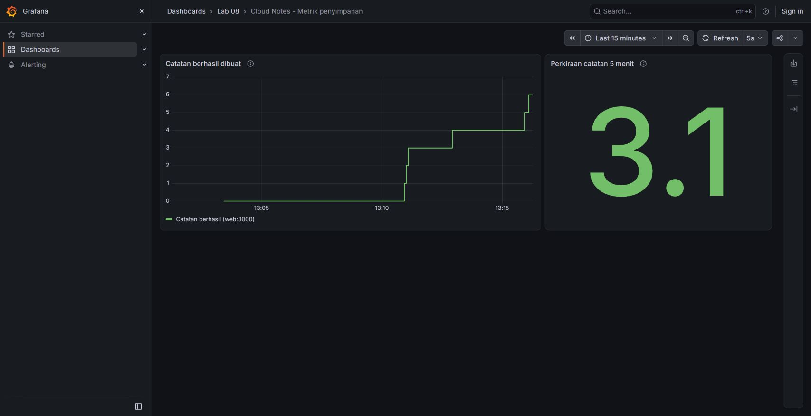

# Lab 08 — Cloud Notes dengan Next.js dan Docker Compose

**Kebijakan kelas:** Lab ini latihan formatif, tanpa tugas, nilai, atau penyerahan terpisah. Satu proyek besar dikerjakan oleh kelompok **3 orang**, dengan presentasi checkpoint minggu 7 (UTS) dan hasil akhir minggu 14 (UAS). Simpan hasil lab hanya bila berguna sebagai referensi atau bukti proses proyek. Baca [brief proyek kelompok](PROYEK_KELOMPOK.md). Bobot resmi tetap mengikuti RPS/LMS.

Cloud Notes menjalankan **Next.js, API Lab 06, PostgreSQL, dan Redis**. Browser membuka Next.js di port 3000. Saat kamu menyimpan catatan, Next.js meneruskannya ke API. Profil **monitoring** menambahkan Prometheus untuk membaca jumlah penyimpanan yang berhasil dan Grafana untuk menggambarnya. Kamu bisa mengikuti latihan yang sama di laptop atau GitHub Codespaces.

## Mulai di sini

| Kalau kamu ingin… | Buka bagian ini |
|---|---|
| Menjalankan aplikasi untuk pertama kali | [Docker di laptop (jalur utama)](#a-docker-di-laptop) atau [GitHub Codespaces](#b-github-codespaces) |
| Membuat proyek baru dan mengenali halaman, layout, serta komponen | [Latihan Next.js dari nol](#latihan-nextjs-dari-nol) |
| **Membuat catatan dan melihat grafiknya, dari nol** | [Monitoring Cloud Notes dengan Prometheus dan Grafana](#monitoring-cloud-notes) |
| Membuat metrik satu menit dan mendesain panel sendiri | [Tambahkan recording rule](#metrik-satu-menit) lalu [buat panel Grafana](#panel-grafana-sendiri) |
| Mencoba alur simpan, memeriksa input, dan memulihkan API | [Latihan inti](#latihan-inti-untuk-kedua-jalur) dan [cek keamanan web](#cek-keamanan-web) |
| Menemukan berkas yang mengatur halaman, warna tombol, dan API | [Peta berkas](#peta-berkas) |
| **Mengubah tampilan web dan melihat hasilnya** | [Tutorial modifikasi halaman Cloud Notes](#modifikasi-halaman-cloud-notes) |
| Memakai server pengembangan Node.js | [Jalur manual dengan next dev](#jalur-manual-nodejs) |
| Mencoba Supabase di Docker lokal atau Codespaces | [Mode Supabase di Docker Compose](#mode-supabase-di-docker-compose) |
| Menerbitkan versi latihan ke Vercel dan menyinkronkan pengaturan Supabase | [Hubungkan Supabase yang sudah ada ke Vercel](#hubungkan-supabase-yang-sudah-ada-ke-vercel) |

Untuk kelas ini, gunakan [branch lab08-docker-codespaces](https://github.com/SeedFlora/meet8CloudService/tree/lab08-docker-codespaces). Di versi yang memuat latihan monitoring, folder `monitoring` dan berkas `compose.yaml` terlihat berdampingan. Coba latihan pilihanmu ketika aplikasi masih berjalan, kemudian ikuti **Selesai latihan**.

## A. Docker di laptop

1. Di Windows, pasang Docker Desktop jika belum ada. Jalankan installer dan ikuti petunjuk WSL 2 jika diminta. Buka **Start → Docker Desktop** dan tunggu engine berjalan. Node.js, Python, database, Prometheus, serta Grafana tersedia lewat image Docker. [Panduan instalasi Docker Desktop untuk Windows](https://docs.docker.com/desktop/setup/install/windows-install/)
2. **Pilih satu cara mengambil repo.** Lewat browser, buka [branch kelas](https://github.com/SeedFlora/meet8CloudService/tree/lab08-docker-codespaces), klik **Code → Download ZIP**, lalu **Extract All**. Buka folder hasil ekstrak sampai terlihat `compose.yaml` dan `monitoring`. Klik bilah alamat File Explorer, ketik `powershell`, lalu Enter. Jika sudah memiliki Git, buka PowerShell di folder kerja pilihanmu dan gunakan dua perintah berikut sebagai alternatif ZIP.

   ```powershell
   git clone --branch lab08-docker-codespaces --single-branch https://github.com/SeedFlora/meet8CloudService.git
   cd meet8CloudService
   ```

3. Periksa folder dan Docker. Ketik `Test-Path .\compose.yaml` dan pastikan hasilnya `True`. Jalankan `docker version` dan cari bagian **Server**, lalu `docker compose version` dan cari nomor versi. Build pertama memerlukan internet untuk mengunduh image dan paket.
4. **Untuk melihat metrik dan grafik**, lanjut langsung ke [langkah 1 monitoring](#monitoring-cloud-notes). **Untuk latihan Cloud Notes dasar**, jalankan dua perintah ini satu per satu.

   ```powershell
   docker compose up --build -d --wait
   docker compose ps
   ```

5. Untuk latihan dasar, buka [Cloud Notes di port 3000](http://127.0.0.1:3000). Cari tulisan **Mode aktif: API lokal**. Jika port 3000 sudah dipakai, set `$env:LAB08_PORT = '3002'` di PowerShell sebelum `docker compose up`, lalu gunakan port 3002 di browser.

## B. GitHub Codespaces

1. Masuk ke GitHub. Dari halaman branch kelas, klik **Code → Codespaces → Create codespace on lab08-docker-codespaces**, atau buka formulir langsung lewat tautan di akhir langkah ini. Jika formulir menampilkan pilihan, cocokkan repo **SeedFlora/meet8CloudService**, branch **lab08-docker-codespaces**, dan konfigurasi **Cloud Notes (Lab 08)**, lalu klik **Create codespace**. Docker akan berjalan di mesin GitHub. Akses Codespaces mengikuti kuota dan pengaturan akun masing-masing. [Buka formulir Codespaces untuk branch kelas](https://codespaces.new/SeedFlora/meet8CloudService/tree/lab08-docker-codespaces)
2. Tunggu penyiapan pertama, termasuk `postCreateCommand`, selesai. Empat layanan inti dibangun otomatis. Di editor klik **Terminal → New Terminal**. Pada terminal **bash**, jalankan `ls compose.yaml monitoring` untuk memastikan kedua sumber kelas tersedia, kemudian `docker compose ps`. Salinan baru dari template GitHub kadang menampilkan branch lokal `main`; jika kedua sumber kelas tadi terlihat, lanjutkan di folder itu. Cari `web`, `api`, `db`, dan `cache`. **Untuk metrik dan grafik**, lanjut ke [langkah 1 monitoring](#monitoring-cloud-notes). Jika hanya mengikuti latihan dasar dan keempat layanan masih berhenti sesudah penyiapan, mulai dengan perintah berikut.

   ```bash
   docker compose up --build -d --wait
   docker compose ps
   ```

3. Pada tab **Ports**, cari **Cloud Notes** pada port **3000**. Pilih **Open in Browser** dan pertahankan visibilitas **Private**. Dari terminal Codespace, `http://127.0.0.1:3000` menunjuk ke server di Codespace.

   Jika 3000 belum muncul di daftar, pilih **Add Port**, masukkan `3000`, lalu pastikan visibilitasnya **Private**. [Panduan port GitHub Codespaces](https://docs.github.com/en/codespaces/developing-in-a-codespace/forwarding-ports-in-your-codespace)

## Latihan inti untuk kedua jalur

1. Isi judul dan isi catatan latihan di browser, klik **Simpan**, lalu refresh. Temukan kembali judul yang sama di daftar.
2. Tambahkan `/api/health` dan `/api/ready` ke URL aplikasi pada tab terpisah. Saat normal, keduanya mengembalikan HTTP **200**. `health` mengecek proses Next.js, sedangkan `ready` mengecek API Lab 06.
3. Jalankan checker dari root repo. Checker membuat satu catatan uji, memeriksa status GET dan POST, request ID, serta respons untuk input yang ditolak.

   ```text
   docker compose exec -T web npm run check:local
   ```

4. Simulasikan gangguan di stack latihanmu. Hentikan hanya service `api`, refresh Cloud Notes dan periksa lagi kedua endpoint. `health` tetap **200**, sementara `ready` dan `/api/notes` menjadi **503**. Nyalakan kembali API, lalu cek `ready` dan `/api/notes` kembali **200** serta catatan sebelumnya tetap muncul.

   ```text
   docker compose stop api
   docker compose up -d --wait api
   ```

   Jalankan baris kedua setelah selesai mengamati gangguan. Untuk melihat log Next.js, gunakan `docker compose logs --tail 30 web`.

### Cek keamanan web

- **Validasi di server.** Bandingkan catatan valid dengan judul kosong, JSON bertipe salah, atau judul melewati batas. Checker menunjukkan HTTP **400** untuk bentuk atau isi yang wajib diisi dan **422** untuk panjang yang melampaui batas. Next.js menolak request itu sebelum meneruskannya ke API Lab 06.
- **Batasi akses jaringan.** Pada profil dasar, `web` menerbitkan port browser. Pada profil monitoring, Prometheus dan Grafana juga menerbitkan port di `127.0.0.1`. API, PostgreSQL, dan Redis tetap berada di jaringan internal Compose. Di Codespaces, periksa bahwa setiap port latihan berstatus **Private**.
- **Pisahkan data latihan dan konfigurasi.** Pakai catatan contoh. Untuk pengayaan Supabase, gunakan publishable key di browser dan pertahankan service-role key di server. Uji isolasi catatan antarpengguna melalui RLS dari Lab 07.

### Selesai latihan

Jalankan `docker compose --profile monitoring down` jika memakai monitoring atau `docker compose down` untuk empat layanan dasar. Perintah tersebut mempertahankan volume beserta catatan, sampel Prometheus, dan dashboard pribadi yang sudah disimpan. Untuk sesi berikutnya di mesin yang sama, jalankan kembali perintah `up` dari jalur pilihanmu. Di GitHub, buka **Your codespaces**, klik menu tiga titik pada mesin latihanmu dan pilih **Stop codespace**. [Cara menghentikan Codespace](https://docs.github.com/en/codespaces/developing-in-a-codespace/stopping-and-starting-a-codespace)

## Peta berkas

Mulai dari folder yang berisi `compose.yaml`. Klik nama berkas di tabel untuk melihat sumbernya di GitHub. Buat perubahan di salinan proyek yang kamu jalankan.

| Berkas | Apa yang akan kamu temukan |
|---|---|
| [src/app/page.tsx](src/app/page.tsx) | Judul halaman, kalimat pembuka, formulir, tombol Simpan, serta daftar catatan. |
| [src/app/globals.css](src/app/globals.css) dan [postcss.config.mjs](postcss.config.mjs) | Pengaturan Tailwind CSS dan gaya dasar, termasuk aturan tombol. |
| [src/app/layout.tsx](src/app/layout.tsx) dan [src/app/ai/layout.tsx](src/app/ai/layout.tsx) | Layout global berisi dokumen HTML, metadata, dan CSS. Layout bagian `/ai` menambahkan tautan kembali di luar isi halaman. |
| [PageHeading](src/components/PageHeading.tsx) dan [NoteCard](src/components/NoteCard.tsx) | Komponen React dengan props TypeScript. Judul dipakai pada dua halaman dan kartu dipakai untuk setiap catatan. |
| [src/app/api/notes/route.ts](src/app/api/notes/route.ts) | Route Handler Next.js untuk GET/POST, validasi masukan, serta penerusan catatan ke API. |
| [compose.yaml](compose.yaml) dan [Dockerfile](Dockerfile) | Empat layanan inti, dua layanan profil monitoring, port, volume, dan build web. |
| [Counter penyimpanan](src/lib/note-metrics.ts) dan [endpoint metrik](src/app/api/metrics/route.ts) | Cara web menyimpan nilai counter di memori dan mengirim teks Prometheus dari `/api/metrics`. |
| [Konfigurasi Prometheus](monitoring/prometheus/prometheus.yml) dan [recording rules](monitoring/prometheus/cloudnotes.rules.yml) | Target yang dibaca, interval lima detik, dan rumus metrik lima menit. |
| [Sumber Prometheus di Grafana](monitoring/grafana/provisioning/datasources/prometheus.yml) dan [dashboard kelas](monitoring/grafana/dashboards/cloud-notes-metrics.json) | Koneksi internal dan definisi dua panel yang langsung tersedia. |
| [tests/challenge.mjs](tests/challenge.mjs) | Dua belas pemeriksaan yang dijalankan lewat `npm run check:local`. |

## Latihan Next.js dari nol

### 1. Buat proyek baru dengan TypeScript, Tailwind, dan App Router

Buka terminal pada folder latihan terpisah, misalnya folder kerja lain di drive data laptop. Jika memakai Codespaces, buka terminal baru, buat folder `~/lab08-latihan`, lalu masuk ke folder itu. Pastikan `node --version` menampilkan versi 22 atau lebih baru. Jika Node belum tersedia di laptop, ikuti [panduan instalasi Next.js](https://nextjs.org/docs/app/getting-started/installation). Stack Docker pada bagian A dan B sudah membundel Node untuk Cloud Notes.

```bash
npx create-next-app@16.4.6 lab08-next-starter --ts --tailwind --app --src-dir --use-npm --no-linter --no-cache-components --disable-git --yes
cd lab08-next-starter
npm run dev -- --hostname 0.0.0.0 --port 3010
```

Tunggu pesan bahwa proyek dibuat dan server siap. Buka [port 3010 di laptop](http://127.0.0.1:3010). Pada Codespaces pilih **Ports → Add Port → 3010 → Open in Browser** dan gunakan visibilitas **Private**. Cloud Notes bisa tetap berjalan di port 3000. [Pilihan resmi create-next-app](https://nextjs.org/docs/app/api-reference/cli/create-next-app)



### 2. Kenali halaman dan uji satu kelas Tailwind

Buka `src/app/page.tsx` di folder `lab08-next-starter`. Ganti isinya dengan contoh ini dan simpan. Dev server menampilkan perubahan ketika browser dimuat ulang.

```tsx
export default function Home() {
  return (
    <main className="mx-auto max-w-xl px-6 py-16">
      <h1 className="text-3xl font-semibold text-sky-700">Latihan App Router Lab 08</h1>
      <p className="mt-3">TypeScript dan Tailwind sudah aktif.</p>
    </main>
  )
}
```

`page.tsx` memberikan isi alamat `/`. Coba ubah `text-sky-700` menjadi `text-violet-700`, simpan, lalu cocokkan warna judul di browser. Template versi ini memasang Tailwind bersama Turbopack. Repo Cloud Notes menjalankan Tailwind melalui PostCSS dengan utilitas yang sama dan mempertahankan gaya dasarnya. Selesai menguji starter, tekan **Ctrl+C** di terminal yang menjalankannya. [Panduan Tailwind CSS pada Next.js](https://tailwindcss.com/docs/installation/framework-guides/nextjs)



### 3. Baca komponen dan layout pada Cloud Notes

Kembali ke folder Cloud Notes dan buka alamat aplikasi yang sudah berjalan.

1. Buka [`src/app/layout.tsx`](src/app/layout.tsx). Temukan `<html lang="id">`, metadata, impor CSS, dan posisi `{children}`. Bandingkan judul tab dengan judul di dalam halaman.
2. Buka [`src/app/ai/layout.tsx`](src/app/ai/layout.tsx), lalu klik **Tanya AI** dari beranda. Layout khusus bagian `/ai` menampilkan tautan **← Cloud Notes**, sedangkan [`src/app/ai/page.tsx`](src/app/ai/page.tsx) menampilkan prompt dan formulir.
3. Buka [`src/components/PageHeading.tsx`](src/components/PageHeading.tsx) dan cari pemanggilannya pada kedua halaman. Prop `title` memberi teks judul. `children` menerima isi tambahan seperti paragraf pengantar. Ubah kelas `text-balance` menjadi `text-balance text-sky-700` di salinan latihan, lalu bangun ulang `web`. Kedua halaman memakai perubahan yang sama.
4. Buka [`src/components/NoteCard.tsx`](src/components/NoteCard.tsx). Periksa tipe `title` dan `content`, serta kelas Tailwind `whitespace-pre-wrap`. Buat dua catatan dengan judul dan isi berbeda. Tambahkan baris baru pada salah satu isi. Perhatikan kedua kartu memakai struktur yang sama dan baris baru tetap terlihat. [Contoh layout dan halaman App Router](https://nextjs.org/docs/app/getting-started/layouts-and-pages)

```bash
docker compose up -d --build --wait --no-deps web
```





### 4. Uji GET dan POST pada Route Handler Cloud Notes

Gunakan **Mode aktif: API lokal** dan cek bahwa stack Cloud Notes sehat. Buka [`src/app/api/notes/route.ts`](src/app/api/notes/route.ts) dan cari fungsi `GET` serta `POST`. Di Codespaces jalankan perintah ini dari terminal. Jika memilih port berbeda, sesuaikan nomor port.

```bash
curl -i http://127.0.0.1:3000/api/notes
curl -i http://127.0.0.1:3000/api/notes -H 'Content-Type: application/json' -d '{"title":"Uji Route Handler","content":"Catatan POST dari terminal"}'
curl -i http://127.0.0.1:3000/api/notes
```

Di PowerShell gunakan bentuk berikut.

```powershell
Invoke-WebRequest -Uri 'http://127.0.0.1:3000/api/notes'
$body = @{title='Uji Route Handler'; content='Catatan POST dari terminal'} | ConvertTo-Json -Compress
Invoke-WebRequest -Uri 'http://127.0.0.1:3000/api/notes' -Method Post -ContentType 'application/json' -Body $body
Invoke-WebRequest -Uri 'http://127.0.0.1:3000/api/notes'
```

Baca **200** pada GET dan **201** pada POST. Cocokkan judul yang dibuat dengan hasil GET terakhir, lalu muat ulang Cloud Notes. Inilah jalur penyimpanan lokal melalui Route Handler. Jalur Supabase dan Vercel diuji dengan akun aplikasi dan Table Editor di bagian terpisah. [Route Handler Next.js](https://nextjs.org/docs/app/getting-started/route-handlers)



## Monitoring Cloud Notes

**Sasaran latihan.** Simpan dua catatan di Cloud Notes, buktikan counter naik dua kali, dan temukan perubahan yang sama di Grafana. Sesudah itu, buat metrik satu menit dan panel buatanmu sendiri. Counter, aturan lima menit, koneksi Prometheus, dan dashboard contoh sudah disertakan di branch ini.

### 1. Nyalakan aplikasi dan alat monitoring

- **Laptop baru** — selesaikan langkah 1–3 di [Docker di laptop](#a-docker-di-laptop) sampai PowerShell berada di folder `compose.yaml` dan `docker version` menampilkan **Server**.
- **Codespace baru** — selesaikan langkah 1–2 di [GitHub Codespaces](#b-github-codespaces). Tunggu empat layanan awal siap. Gunakan terminal **bash** di editor browser.

Di terminal yang sudah kamu siapkan, jalankan baris berikut satu per satu. Perintah pertama juga bisa dipakai jika sebelumnya hanya menyalakan latihan dasar.

```text
docker compose --profile monitoring up --build -d --wait
docker compose --profile monitoring ps
```

**Periksa hasilnya.** Cari enam layanan dengan status sehat: `web`, `api`, `db`, `cache`, `prometheus-lab08`, dan `grafana-lab08`. Biarkan semuanya berjalan selama latihan.

### 2. Buka tiga tab di browser

| Tab | Docker di laptop | GitHub Codespaces |
|---|---|---|
| Cloud Notes | [Buka aplikasi · 3000](http://127.0.0.1:3000) | **Ports → 3000 → Open in Browser** |
| Prometheus | [Buka target · 9091](http://127.0.0.1:9091/targets) | **Ports → 9091 → Open in Browser**, lalu **Status → Target health** |
| Grafana | [Buka dashboard kelas · 3301](http://127.0.0.1:3301/d/cloud-notes-metrics/) | **Ports → 3301 → Open in Browser**, lalu **Dashboards → Lab 08 → Cloud Notes - Metrik penyimpanan** |

Di Codespaces, **Ports** berada di panel bawah di samping **Terminal**. Jika nomor belum terlihat, pilih **Add Port**, ketik nomor, lalu tekan Enter. Pada setiap baris pastikan **Visibility → Private**, kemudian klik ikon globe atau klik kanan **Open in Browser**. Alamat HTTPS milik teman akan berbeda dari alamatmu.



### 3. Lihat angka awal dan pastikan target UP

1. Buka tab Cloud Notes. Buat tab salinan, tambahkan `/api/metrics` pada alamat aplikasi, kemudian tekan Enter. Cari tiga baris di bawah. Baris terakhir berisi angka milikmu. **Catat angka awal** sebelum menguji tombol Simpan.

   ```text
   # HELP cloudnotes_notes_created_total Successful note creations seen by this web process.
   # TYPE cloudnotes_notes_created_total counter
   cloudnotes_notes_created_total 0
   ```

2. Di tab Prometheus buka **Status → Target health**. Cari job `cloudnotes_web`, endpoint `http://web:3000/api/metrics`, dan status **UP**. UP berarti sampel terakhir berhasil dibaca. Prometheus mengambil satu sampel setiap lima detik.
3. Pilih **Query**, masukkan `up{job="cloudnotes_web"}`, klik **Execute** lalu pilih **Table**. Nilai yang diharapkan adalah **1**. Ganti dengan kueri berikut dan klik **Execute** lagi. Tunggu sekitar 15 detik untuk memberi Prometheus beberapa sampel awal sebelum percobaan berikut.

   ```promql
   cloudnotes_notes_created_total{job="cloudnotes_web"}
   ```



### 4. Simpan dua catatan dan buktikan apa yang dihitung

1. Di tab Cloud Notes, isi **Judul** dengan `Metrik satu`, dan **Isi** dengan `Percobaan pertama`. Klik **Simpan** sekali. Tunggu sampai catatan muncul di daftar.
2. Muat ulang `/api/metrics`. Counter seharusnya naik satu dari angka awal. Tunggu sekitar 6–10 detik, kembali ke tab Prometheus, lalu **Execute** untuk membaca sampel terbaru.
3. Simpan sekali lagi dengan judul `Metrik dua` dan isi `Percobaan kedua`. Ulangi pengecekan tadi. Misalnya, jika angka awal **0**, urutannya **0 → 1 → 2**. Jika angka awal **7**, hasil akhirnya **9**.
4. Muat ulang daftar catatan tiga kali. Setelah Prometheus mengambil sampel berikutnya, jalankan kueri yang sama. Nilainya tetap jika hanya kamu yang memakai mesin itu. Di **Graph**, pilih rentang yang mencakup percobaan untuk melihat kenaikannya.



**Dari mana angka itu berasal?** Buka tiga bagian kode berikut sesuai urutan kejadian.

| Ketika kamu… | Yang dilakukan aplikasi |
|---|---|
| Menyimpan catatan | Route `/api/notes` memanggil `noteCreated()` setelah API mengembalikan **201** untuk **POST**. GET membaca daftar. Judul kosong menghasilkan 400 sebelum permintaan diteruskan. [Lihat pemicu counter](src/app/api/notes/route.ts) |
| Membuka `/api/metrics` | `metricsText()` menyusun HELP, TYPE, dan nilai counter. Nilai disimpan di memori proses web dan mulai dari nol saat proses baru berjalan. Catatan yang sudah tersimpan di PostgreSQL tetap bisa dibaca setelah web di-restart. [Lihat counter](src/lib/note-metrics.ts) · [Lihat endpoint](src/app/api/metrics/route.ts) |
| Menjalankan checker | Checker melakukan beberapa uji dan membuat satu catatan valid. Counter naik satu dari penyimpanan itu. [Lihat checker](tests/challenge.mjs) |

<details>
<summary>Uji tambahan: buktikan permintaan berstatus 400 mempertahankan nilai counter</summary>

Catat nilainya. Di terminal proyek jalankan `docker compose exec web node` untuk membuka Node di kontainer web. Pada prompt `>`, ketik setiap baris berikut dan tekan Enter.

```js
const url = 'http://127.0.0.1:3000/api/notes'
const headers = {'Content-Type': 'application/json'}
const body = JSON.stringify({title: '', content: 'Uji judul kosong'})
(await fetch(url, {method: 'POST', headers, body})).status
```

Baris terakhir menampilkan **400**. Ketik `.exit`, lalu muat ulang `/api/metrics` dan cocokkan counter dengan nilai sebelumnya.

</details>

### 5. Hubungkan angka mentah dengan dua panel contoh

Di Prometheus buka **Status → Rule health**, perluas grup `cloudnotes_lab`, lalu cari **OK** untuk `job:cloudnotes_notes_created:increase5m`. Sebuah *recording rule* menjalankan kueri secara berkala dan menyimpan hasilnya dengan nama metrik baru. Aturan kelas mengevaluasi perkiraan pertambahan counter lima menit terakhir setiap lima detik. [Lihat rumusnya](monitoring/prometheus/cloudnotes.rules.yml)

Di Grafana buka **Cloud Notes - Metrik penyimpanan**. Pilih **Last 15 minutes**, klik panah di sebelah **Refresh**, lalu pilih **5s**. Baca kedua panel.

| Panel dan kueri | Cara membaca |
|---|---|
| **Catatan berhasil dibuat** — `cloudnotes_notes_created_total{job="cloudnotes_web"}` | **Time series / Range** menggambar counter mentah sepanjang rentang tampilan. Ujung garis mengikuti nilai terbaru di Prometheus. |
| **Perkiraan catatan 5 menit** — `job:cloudnotes_notes_created:increase5m{job="cloudnotes_web"}` | **Stat / Instant** menampilkan hasil aturan terakhir. Fungsi `increase` memperkirakan perubahan sampai tepi jendela pengamatan dan memperhitungkan reset counter. Karena itu, setelah tiga simpan, kamu bisa melihat misalnya **3,1**. Ketika lima menit berlalu tanpa simpan baru, perkiraan dapat kembali ke nol. [Fungsi increase](https://prometheus.io/docs/prometheus/latest/querying/functions/#increase) |



Pada contoh **Docker lokal** di atas, tiga kali simpan membawa garis dari 0 ke 3. Pada contoh **Codespaces** di bawah, garis mencapai 6, sedangkan Stat membaca 3,1. Garis mencakup semua penyimpanan sejak web dinyalakan. Stat memperkirakan penyimpanan selama lima menit terakhir. Angkamu mengikuti catatan dan waktu percobaanmu sendiri.



Grafana sudah memperoleh sumber data **Lab 08 Prometheus** dari konfigurasi repo. Server Grafana menghubungi `http://prometheus-lab08:9090` lewat jaringan Docker. Browser di laptop mengakses Prometheus lewat port `9091`; browser untuk Codespaces memakai tautan privat dari **Ports**. Keduanya menuju Prometheus di mesin latihan masing-masing. [Lihat koneksi Grafana](monitoring/grafana/provisioning/datasources/prometheus.yml)

<a id="metrik-satu-menit"></a>
### 6. Buat metrik baru untuk satu menit

Sekarang beri dashboard pertanyaan baru: **berapa tambahan catatan dalam satu menit terakhir?** Kamu akan memakai counter yang sama dan menambahkan satu recording rule pada salinan proyekmu.

1. Di laptop buka **VS Code → File → Open Folder** dan pilih folder yang berisi `compose.yaml`. Di Codespaces gunakan **Explorer** di kiri. Buka **monitoring → prometheus → cloudnotes.rules.yml**.
2. Cari daftar `rules:` di bawah grup `cloudnotes_lab`. Tambahkan dua baris berikut tepat di bawah aturan lima menit yang sudah ada. Sejajarkan tanda `-` baru dengan tanda `-` milik `record` lama. Pertahankan spasi awal dan tekan **Ctrl+S**.

   ```yaml
         - record: job:cloudnotes_notes_created:increase1m
           expr: sum by (job) (increase(cloudnotes_notes_created_total{job="cloudnotes_web"}[1m]))
   ```

3. Di terminal proyek, periksa berkas yang disimpan. Perintah pertama memakai `promtool` dari image kelas. Cari **SUCCESS** dengan **2 rules found**. Jika ada pesan kesalahan, perbaiki baris YAML yang disebutkan dan ulangi perintah pertama. Setelah sukses, jalankan perintah kedua untuk memuat aturan baru.

   ```text
   docker compose --profile monitoring run --rm --no-deps --entrypoint promtool prometheus-lab08 check rules /etc/prometheus/cloudnotes.rules.yml
   docker compose --profile monitoring up -d --no-deps --force-recreate --wait prometheus-lab08
   ```

4. Buka kembali **Prometheus → Status → Rule health**. Cari dua nama, `increase5m` dan `increase1m`, keduanya **OK**. Tunggu dua pengambilan sampel dan satu evaluasi. Simpan satu catatan baru di Cloud Notes lalu klik **Query → Execute** dengan kueri di bawah. Setelah sekitar satu menit tanpa simpan baru, jalankan lagi. Bandingkan hasilnya dengan aturan lima menit.

   ```promql
   job:cloudnotes_notes_created:increase1m{job="cloudnotes_web"}
   ```

<a id="panel-grafana-sendiri"></a>
### 7. Tambahkan panel untuk metrik buatanmu

1. Pada tab Grafana klik **Sign in**. Jika tombolnya tersembunyi, buka `/login` pada alamat Grafana yang sama. Untuk volume latihan baru di laptop atau Codespace privatmu, pengguna awal adalah `admin` dengan sandi awal `admin`. Ikuti permintaan mengganti sandi. Jika sudah pernah masuk, gunakan sandi yang kamu simpan.
2. Klik **Dashboards → New → New dashboard**. Pada layar awal pilih **Custom grid**. Pada laci **Add** di kanan klik kartu **Panel**, lalu **Configure visualization** di panel kosong. Jika lacinya tertutup, klik **+ Add** pada bilah vertikal kanan.
3. Di **Queries**, pilih data source **Lab 08 Prometheus**. Pada baris **A**, pilih **Code**, tempel kueri `job:cloudnotes_notes_created:increase1m{job="cloudnotes_web"}`, buka **Options**, pilih **Type → Instant**, lalu **Run queries**.
4. Di kanan buka **All visualizations → Stat**. Untuk panel yang sudah memiliki jenis visual, pilih **Change** dahulu. Pada **Panel options → Title** ketik `Perkiraan catatan 1 menit`. Pada **Standard options → Decimals**, isi `1`.
5. Klik **Back** untuk kembali ke dashboard, lalu **Save**. Pada dialog pertama, beri judul `Monitoring Cloud Notes Saya`, pilih folder jika diminta, lalu **Save** lagi. Untuk judul dashboard dan panel di Codespaces, gunakan huruf A–Z, angka, spasi, atau tanda hubung biasa (`-`). Grafana mengirim judul saat meminta data dan simbol seperti `·` bisa membuat permintaan ditolak.
   Buka **Dashboards**, cari judul itu dan buka kembali. Pilih **Last 15 minutes** dan **Refresh → 5s** pada dashboard barumu. Simpan satu catatan dan lihat nilainya setelah Prometheus mengambil sampel dan mengevaluasi aturan.
6. **Coba tampilan kedua.** Masuk **Edit**, pilih judul panel, lalu **Duplicate** di sidebar kanan. Pilih salinannya → **Edit visualization → Change → Time series**. Pada **Options** kueri ubah **Type** ke **Range** dan klik **Run queries**. Beri judul `Riwayat perkiraan 1 menit`. Pada **Graph styles → Style**, pilih **Bars**. Klik **Back**, geser judul panel untuk mengatur posisi, tarik sudut kanan bawah untuk mengubah ukurannya, lalu **Save**. Sekarang kamu punya nilai terbaru dan riwayatnya di satu layar.

Dashboard **Monitoring Cloud Notes Saya** tersimpan di volume Grafana pada mesin latihanmu. Dashboard bawaan dimuat dari JSON ketika stack dijalankan. Jika kamu ingin mendistribusikan perubahan pada dashboard bawaan melalui repo milikmu, edit JSON sumbernya dan pertahankan UID `cloud-notes-metrics` serta UID data source `lab08-prometheus`. [Definisi dashboard bawaan](monitoring/grafana/dashboards/cloud-notes-metrics.json)

### Jika angka atau halaman belum muncul

| Gejala | Langkah berikutnya |
|---|---|
| `no configuration file provided` atau layanan monitoring tidak muncul | Buka kembali terminal di folder dengan `compose.yaml` dan folder `monitoring`, pada branch kelas. Jalankan `docker compose --profile monitoring config --services` dan cocokkan enam nama layanan, lalu mulai dari langkah 1. |
| `port is already allocated` di Windows | Untuk port yang bentrok, set variabelnya di PowerShell yang sama, misalnya `$env:LAB08_GRAFANA_PORT='3302'`, `$env:LAB08_PROMETHEUS_PORT='9092'` atau `$env:LAB08_PORT='3002'`. Jalankan ulang perintah `up`, lalu buka nomor baru untuk layanan itu. URL Docker pada data source tetap `http://prometheus-lab08:9090`. |
| Codespaces membuka 502 atau halaman login GitHub | Tunggu build selesai, jalankan perintah `ps` pada langkah 1, lalu buka kembali baris **Ports** milik mesinmu. Masuk dengan akun pemilik Codespace dan pertahankan **Private**. |
| Target `DOWN` atau metrik kosong | Buka `/api/metrics` dari tab Cloud Notes. Periksa log dengan `docker compose --profile monitoring logs --tail 30 web prometheus-lab08`. Cocokkan job `cloudnotes_web` dan target `web:3000`. |
| Counter terlihat, tetapi panel lima menit menampilkan **No data** | Cari rule pada **Status → Rule health**, tunggu beberapa sampel, pilih **Last 15 minutes** dan klik **Refresh**. Nilai nol setelah cukup sampel berarti belum ada kenaikan dalam jendela itu. |
| Grafana terlihat tetapi tombol **Edit** tidak ada | Tampilan awal mengizinkan pengunjung melihat grafik. Masuk melalui `/login` di instance privatmu dan ikuti langkah 7. |

Saat selesai gunakan `docker compose --profile monitoring down`. Di Codespaces, lanjutkan dengan **Stop codespace**. [Penutupan dan penyimpanan data](#selesai-latihan)

## Modifikasi halaman Cloud Notes

Sesudah langkah ini, halaman akan berjudul **Cloud Notes Kelas Saya** dan tombolnya akan berbunyi **Simpan catatan** dengan latar hijau tua. Latihan ini memakai Docker yang sudah berjalan, baik di laptop maupun di dalam Codespace.

### 1. Buka proyek yang sedang berjalan

- **Docker lokal (Windows).** Buka File Explorer di folder hasil ekstraksi atau clone yang dipakai saat menjalankan Compose. Pastikan `compose.yaml` dan folder `src` terlihat. Di VS Code pilih **File → Open Folder…**, pilih folder tersebut, lalu **Select Folder**. Untuk mengetik perintah, gunakan PowerShell yang tadi dipakai menjalankan Compose.
- **Codespaces.** Kembali ke tab browser yang menampilkan editor GitHub Codespaces. Buka **Explorer** di kiri dan **Terminal** di panel bawah. Saat Codespace baru dibuat, tunggu proses `postCreateCommand` selesai, lalu gunakan terminal **bash** untuk perintah berikut. Tab yang membuka Cloud Notes lewat **Ports → 3000 → Open in Browser** dipakai untuk melihat hasil.

Di terminal folder proyek, ketik `docker compose ps`. Cari `web`, `api`, `db`, dan `cache` dengan status **healthy**. Jika sudah menutup stack, mulai lagi dari bagian A atau B. Pada halaman utama, simpan satu catatan dengan judul `Sebelum modifikasi` dan isi `Saya akan membangun ulang web.` Muat ulang halaman dan cari catatan itu. Kita akan mencarinya sekali lagi setelah tampilan berubah.

### 2. Ganti judul, penjelasan, dan teks tombol

Di Explorer editor, buka **src → app → page.tsx**. Tekan **Ctrl+F** untuk mencari teks pada kolom kiri. Tekan **Esc** untuk kembali ke editor, pilih **hanya teks yang ditemukan**, lalu ketik penggantinya. Pertahankan tag HTML dan ekspresi di sekitarnya.

| Cari | Ganti menjadi |
|---|---|
| `<PageHeading title="Cloud Notes">` | `<PageHeading title="Cloud Notes Kelas Saya">` |
| `Catatan kelas dengan dua jalur data: API Compose lokal atau Supabase Auth + RLS.` | `Catat percobaan cloud dan hasil pengamatan kelas.` |
| `<button disabled={busy}>Simpan</button>` | `<button disabled={busy}>Simpan catatan</button>` |
| `Belum ada catatan yang terlihat.` | `Belum ada catatan. Tulis hasil percobaan pertamamu di atas.` |

Tekan **Ctrl+S**. Pesan pada baris terakhir muncul di bagian **Daftar catatan** saat daftar kosong. Jika datamu sudah berisi catatan, kamu akan melihat daftar itu. Untuk menguji pesan baru secara terpisah, buka Codespace baru dari branch kelas, tunggu stack sehat, lalu terapkan edit langkah 2–4 di mesin itu. Lewati pembuatan catatan awal di mesin kedua dan lihat daftar sebelum menyimpan catatan atau menjalankan checker. Mesin pertama tetap menyimpan data latihanmu.

### 3. Ganti warna tombol dan nama tab

1. Buka **src → app → globals.css**. Cari `background: #1256a0` di aturan `button`. Ganti hanya bagian tersebut menjadi `background: #0f665c`. Pertahankan `color: white` dan properti lain pada baris itu. Tekan **Ctrl+S**. Tombol utama akan berwarna hijau tua dengan teks putih. Kombinasi ini memiliki rasio kontras sekitar 6,8:1 pada tombol aktif.
2. Buka **src → app → layout.tsx**. Di dalam objek `metadata`, ganti `title: 'Cloud Notes',` menjadi `title: 'Cloud Notes | Praktikum 08',`. Pertahankan koma sesudah tanda petik dan tekan **Ctrl+S**. Perubahan ini terlihat di **tab browser**. Judul besar di dalam halaman berasal dari `page.tsx`.

### 4. Bangun ulang web dan lihat hasilnya

Docker menjalankan hasil build Next.js dari image. Setelah menyimpan ketiga berkas, jalankan dua baris berikut **satu per satu** dari folder yang berisi `compose.yaml`. Gunakan terminal yang sama dengan langkah 1. Opsi `--no-deps` membatasi pembuatan ulang ke layanan web yang dipilih. API, PostgreSQL, dan Redis sudah hidup saat kamu memulai tutorial ini.

```text
docker compose up --build -d --wait --no-deps web
docker compose ps
```

Tunggu build selesai dan `web` kembali **healthy**. Di laptop, buka [Cloud Notes pada port bawaan](http://127.0.0.1:3000) atau port 3002 jika sebelumnya kamu memilih port itu. Di Codespaces, kembali ke tab aplikasi yang dibuka melalui port privat 3000. Tekan **Ctrl+Shift+R** di browser untuk memuat ulang halaman beserta CSS. Jika tab terlalu sempit untuk membaca namanya, arahkan pointer ke tab.


Cocokkan **judul halaman**, **kalimat pembuka**, **teks dan warna tombol**, serta **nama tab** dengan contoh yang kamu ketik. Lalu cari `Sebelum modifikasi` pada daftar untuk memastikan catatan masih ada setelah web dibangun ulang. Pakai tombol baru untuk menyimpan satu catatan lagi, misalnya `Sesudah modifikasi`, lalu tekan **Ctrl+R** dan pastikan kedua judul tetap terlihat.

### 5. Periksa fungsi dan keamanan web

```text
docker compose exec -T web npm run check:local
```

Cari ringkasan `challenge: 12 PASS, 0 FAIL`. Teks dan warna diperiksa lewat browser. Checker menguji jalur data dan respons server. Judul kosong serta JSON rusak menghasilkan HTTP 400, masukan yang melampaui batas 120/5.000 karakter menghasilkan 422, dan penyimpanan valid menghasilkan 201 serta header `X-Request-ID`. Checker menambah satu catatan berawalan `Lab08-check-`. Di Codespaces, pertahankan port 3000 **Private**. Pada mode API lokal ini, pengguna yang bisa mengakses aplikasi membaca daftar catatan demo yang sama.

### Jika hasilnya berbeda

| Yang kamu lihat | Yang perlu diperiksa |
|---|---|
| Perubahan belum muncul | Pastikan ketiga berkas sudah tersimpan di folder proyek yang sedang berjalan. Periksa hasil build dan status `web`, lalu tekan **Ctrl+Shift+R** pada tab aplikasi. Cocokkan port di browser dengan `docker compose ps`. |
| Build gagal setelah mengedit TSX | Baca nama berkas dan nomor baris pada **error pertama**. Cocokkan tanda petik, koma, kurung kurawal, dan tag penutup dengan contoh. Perbaiki, simpan, dan ulangi langkah 4. |
| Muncul 502 atau daftar catatan gagal dimuat | Periksa `docker compose ps -a` dan buka `/api/ready` dari alamat aplikasi. Jika ada layanan yang berhenti, jalankan `docker compose up -d --wait` dari folder proyek. Coba lagi ketika semua layanan healthy. |
| Pesan daftar kosong belum muncul | Pesan itu tampil saat jumlah catatan nol. Jika judul catatan terlihat di daftar, halaman sedang menampilkan data yang sudah ada. |

**Mengembalikan tampilan awal.** Balikkan hanya penggantian pada tabel di langkah 2. Kembalikan warna ke `#1256a0` dan judul tab ke `'Cloud Notes'`. Jika memakai Git atau Codespaces, cek dahulu perbedaan pada tiga berkas dengan perintah di bawah agar editmu yang lain tetap tersimpan. Jika memakai ZIP, gunakan tabel penggantian sebagai acuan. Simpan berkas, ulangi langkah 4, dan muat ulang browser. Database tetap memakai volume proyek yang sama.

```text
git diff -- src/app/page.tsx src/app/globals.css src/app/layout.tsx
```

**Menyimpan hasil ke GitHub sendiri (opsional).** Jika ingin membawa desain ke mesin lain, buat fork yang menyertakan branch `lab08-docker-codespaces` (di formulir fork, kosongkan pilihan menyalin hanya branch default jika perlu). Pilih branch kelas di fork milikmu sebelum clone atau membuka Codespace. Setelah mengedit, buka **Source Control**, tinjau perubahan pada `page.tsx`, `globals.css` dan `layout.tsx`, klik **+** untuk file yang ingin disimpan, lalu **Commit** dan **Sync Changes** atau **Publish Branch**. Buka branch itu di GitHub dan periksa perubahan file. Catatan dalam database tetap berada di volume Docker masing-masing.

Saat Cloud Notes masih berjalan, kamu bisa melanjutkan ke [latihan metrik dan panel Grafana di Lab 08](#monitoring-cloud-notes). Contoh terpisah untuk monitoring model ada di [latihan Grafana dan simulator Teori 10](https://github.com/SeedFlora/meet10CloudService/blob/main/ml-monitoring/README.md#modifikasi-tampilan). Sesudah latihan terakhir, ikuti [cara menutup stack dan Codespace](#selesai-latihan).

## Jalur manual Node.js

Gunakan jalur ini saat ingin mengedit kode dengan `next dev`, memakai backend dari pertemuan sebelumnya, atau mengikuti [modul Windows lama](MODUL_MAHASISWA.md) dan [PDF](MODUL_MAHASISWA.pdf). Backend berjalan pada port 18006. Modul membagi backend, frontend, dan pemeriksaan ke tiga terminal.

### Terminal 1 — backend Lab 06

Buka PowerShell di folder tempat menyimpan proyek:

```powershell
git clone https://github.com/SeedFlora/meet6CloudService.git meet6CloudService-local
Set-Location .\meet6CloudService-local
Copy-Item .\.env.example .\.env
docker compose up --build -d --wait
docker compose ps
curl.exe -i http://127.0.0.1:18006/health
```

Gunakan clone Lab 06 yang sudah sehat dari pertemuan sebelumnya sebagai pengganti clone baru. Pada clone lama, pertahankan `.env` dan volume. Hasil health harus HTTP 200 dan menyebut PostgreSQL serta Redis.

### Terminal 2 — frontend Lab 08

Buka PowerShell baru di folder induk yang sama:

```powershell
git clone https://github.com/SeedFlora/meet8CloudService.git meet8CloudService-local
Set-Location .\meet8CloudService-local
node --version
npm --version
npm ci
Copy-Item .\.env.example .\.env.local
npm run dev
```

Node harus versi **22+**, sesuai seluruh dependensi proyek. Buka <http://localhost:3000>. Buat catatan dan cocokkan hasilnya dengan <http://127.0.0.1:18006/notes>. Biarkan terminal 2 menjalankan Next.js.

### Terminal 3 — pemeriksaan

Buka terminal pada folder `meet8CloudService-local`:

```powershell
curl.exe -i http://localhost:3000/api/health
curl.exe -i http://localhost:3000/api/ready
```

Keduanya HTTP 200. Health memeriksa Next.js; ready memeriksa API Lab 06. Ikuti modul untuk uji POST, validasi HTTP 400, pembahasan source, typecheck, dan build. Checker tambahan `npm run check:local` membuat satu catatan uji; bukan prasyarat praktik.

## Tambahan: proxy model AI tanpa GPU (`/api/ai`)

Route Handler `src/app/api/ai/route.ts` meneruskan prompt dari halaman **Tanya AI** (`/ai`) ke provider **OpenAI-compatible**. Untuk demo lokal, isi `AI_BASE_URL` dan `AI_MODEL` di `.env.local`, dengan `AI_API_KEY` hanya jika provider memerlukannya. Simpan key di server, tanpa prefix `NEXT_PUBLIC_`. Jalankan ulang Next.js di loopback dengan `npm run dev -- --hostname 127.0.0.1`.

| Provider | `AI_BASE_URL` | Catatan |
|---|---|---|
| Ollama lokal | `http://127.0.0.1:11434/v1` | gratis dan offline, `AI_API_KEY` dikosongkan; contoh `AI_MODEL=hf.co/bartowski/Qwen2.5-1.5B-Instruct-GGUF:Q4_K_M` |
| Hugging Face Inference Providers | `https://router.huggingface.co/v1` | token HF |
| Groq | `https://api.groq.com/openai/v1` | API key Groq |
| Google Gemini | `https://generativelanguage.googleapis.com/v1beta/openai` | API key Gemini |
| Cloudflare Workers AI | `https://api.cloudflare.com/client/v4/accounts/<ACCOUNT_ID>/ai/v1` | token Cloudflare dengan akses Workers AI |

Jika memakai Ollama, jalankan `ollama pull hf.co/bartowski/Qwen2.5-1.5B-Instruct-GGUF:Q4_K_M` sekali untuk mengunduh model (sekitar 986 MB), lalu pakai nama model yang sama pada `AI_MODEL`. Setelah model tersedia, demo Ollama dapat berjalan offline.

Uji setelah server Next.js di-restart (terminal 3):

```powershell
# Windows PowerShell
Invoke-RestMethod http://127.0.0.1:3000/api/ai -Method Post -ContentType "application/json" -Body '{"prompt":"Apa itu Docker?"}'
```

```bash
# macOS / Linux
curl -s -X POST http://127.0.0.1:3000/api/ai -H 'Content-Type: application/json' -d '{"prompt":"Apa itu Docker?"}'
```

```
node tests/ai-proxy.mjs     # sama di semua OS; harus 3 PASS
```

Kode status: `200` jawaban, `400` prompt kosong/JSON rusak, `502` provider menolak atau responsnya rusak, `503` konfigurasi AI belum aktif, `504` provider mati atau melewati `AI_TIMEOUT_MS`. Cocokkan `X-Request-ID` pada hasil di browser dengan log Next.js.

Endpoint demo tidak memiliki autentikasi dan dinonaktifkan pada build produksi secara bawaan, termasuk di Vercel. Jika ingin menguji build produksi di laptop, set `AI_ENABLE_IN_PRODUCTION=true` dan jalankan `npm run start -- --hostname 127.0.0.1`. Deployment Cloud Notes ke Vercel pada modul tetap bisa dijalankan dengan fitur AI dinonaktifkan.

> **⚠ SESUAIKAN DI DEVICE-MU**
> - **Kecepatan CPU:** cek `ollama run <model> --verbose` → *eval rate*. Di bawah 10 token/detik, isi `AI_TIMEOUT_MS=60000` atau `AI_MAX_TOKENS=150` di `.env.local`, lalu restart server (`.env.local` hanya dibaca saat server mulai).
> - **RAM 4 GB:** pakai `hf.co/bartowski/Llama-3.2-1B-Instruct-GGUF:Q4_K_M` (0,81 GB). `AI_MODEL` harus sama persis dengan output `ollama list`.
> - **Install Ollama:** Windows dan macOS memakai installer dari ollama.com/download (berjalan sebagai aplikasi tray/menu bar); Linux memakai skrip install resmi. Perintah `ollama` sama di semua OS.
> - **Port 3000 terpakai:** `npm run dev -- -p 3001`, lalu sebelum tes set `LAB08_BASE_URL` (PowerShell `$env:LAB08_BASE_URL="http://127.0.0.1:3001"`; macOS/Linux `LAB08_BASE_URL=http://127.0.0.1:3001 node tests/ai-proxy.mjs`).

## Materi pendamping

- [Teori Vercel dan Next.js](slides/Teori_Pertemuan_08.pptx)
- [Slide praktik lokal](slides/LAB08_Cloud_Notes_Nextjs_Bukti_Live.pptx)
- [Git opsional ke repo pribadi](PANDUAN_GIT.md)
- [Proyek kelompok](PROYEK_KELOMPOK.md)

### Mode Supabase di Docker Compose

Cloud Notes pada mode ini memakai Supabase Auth untuk masuk dan tabel `public.notes` untuk menyimpan catatan. Siapkan proyek Supabase latihan terlebih dahulu. Sesudah itu, gunakan jalur Docker di laptop atau Codespaces yang sama seperti pada bagian A atau B.

#### 1. Siapkan tabel, URL, dan kunci proyek

1. Buka [Dashboard Supabase](https://supabase.com/dashboard/projects), lalu pilih proyek latihan. Di **Table Editor**, pilih skema **public** dan cari tabel **notes**. Kolom yang dipakai aplikasi adalah `id`, `title`, `content`, `user_id`, dan `created_at`.
2. Jika tabel belum ada, buka **SQL Editor → New query** di proyek latihan, tempel [`schema.sql` dari Lab 07](https://github.com/SeedFlora/meet7CloudService/blob/main/schema.sql), lalu klik **Run**. Buka kembali **Table Editor → notes** dan pastikan RLS aktif. Jika proyek sudah memiliki tabel dan kebijakan sendiri, periksa kecocokannya sebelum menjalankan skrip.
3. Pada bagian **Connect**, salin **Project URL** dan **Publishable key** dari proyek yang sama. Kunci aplikasi publik biasanya diawali `sb_publishable_`. Gunakan hanya kunci publishable pada konfigurasi browser. [Panduan kunci Supabase](https://supabase.com/docs/guides/getting-started/api-keys)
4. Di Explorer, buka folder yang berisi `compose.yaml`. Buat file **.env** atau buka file itu jika sudah ada. Isi dua baris berikut dengan nilai proyekmu. Nilai contoh di bawah hanya penanda. `.env.example` adalah template kosong untuk dibagikan. Jika kamu sudah terlanjur mengisi template, pindahkan kedua nilainya ke `.env` dan kosongkan kembali kedua baris di template. Compose memakai `.env`. Pada jalur pengembangan `npm run dev`, gunakan `.env.local` seperti di modul.

   ```dotenv
   NEXT_PUBLIC_SUPABASE_URL=https://PROJECT_REF.supabase.co
   NEXT_PUBLIC_SUPABASE_PUBLISHABLE_KEY=sb_publishable_GANTI
   ```

#### 2. Bangun ulang layanan web

Di terminal dari folder yang memuat `compose.yaml`, jalankan dua perintah berikut bila stack awal sehat.

```bash
docker compose config --quiet
docker compose up -d --build --wait --no-deps web
```

Jika seluruh stack berhenti, gunakan `docker compose up -d --build --wait` setelah pemeriksaan konfigurasi berhasil. Nilai publik masuk pada waktu build. Langkah ini memakai kembali volume PostgreSQL dan Redis yang sudah ada. [Variabel publik pada Next.js](https://nextjs.org/docs/app/guides/environment-variables#bundling-environment-variables-for-the-browser)

Muat ulang Cloud Notes. Di laptop, buka [port 3000](http://127.0.0.1:3000). Di Codespaces, buka **Ports → 3000 → Open in Browser** dan pertahankan visibilitas **Private**. Pastikan halaman menampilkan **Mode aktif: Supabase**.

#### 3. Masuk, simpan, dan cocokkan baris di Supabase

1. Jika sudah punya akun aplikasi yang dikonfirmasi pada proyek tadi, klik **Masuk** memakai akun latihan itu. Akun untuk membuka Dashboard Supabase berbeda dari akun aplikasi yang tercatat pada **Authentication → Users**.
2. Jika perlu mendaftar, salin alamat Cloud Notes dari browser dan tambahkan di **Authentication → URL Configuration → Redirect URLs**. Gunakan alamat aplikasi lengkap dengan `https://` di Codespaces atau `http://127.0.0.1:3000` jika itu yang kamu buka di laptop. Aplikasi mengirim alamat asal tab saat kamu klik **Daftar**. Selesaikan konfirmasi email lalu kembali ke Cloud Notes. [Konfigurasi redirect Supabase](https://supabase.com/docs/guides/auth/redirect-urls)
3. Pada **Tulis catatan**, pakai judul unik, misalnya `Uji Supabase Lab 08 13.30`, dan isi singkat yang aman dibagikan. Klik **Simpan** dan pastikan catatan muncul di aplikasi.
4. Di dashboard proyek yang sama, buka **Table Editor → public → notes**. Klik **Filter** pada kolom `title` dan cari judul tadi. Cocokkan `title`, `content`, dan `user_id`. Ini membuktikan permintaan aplikasi membuat baris pada proyek Supabase tersebut.
5. Untuk menunjukkan pembaruan, ubah **hanya** isi catatan uji yang tadi dibuat melalui Table Editor. Simpan, lalu muat ulang Cloud Notes menggunakan akun yang sama dan cocokkan isi baru. Table Editor memakai akses dashboard. Untuk menguji RLS melalui aplikasi, keluar lalu masuk dengan akun latihan kedua. Akun kedua hanya melihat baris miliknya.

Checker **12 uji** dan counter Prometheus memeriksa jalur API lokal Lab 08. Untuk menguji jalur Supabase, gunakan hasil penulisan di Table Editor dan hasil baca pada akun aplikasi. Untuk kembali ke mode lokal, kosongkan dua nilai Supabase di `.env`, ulangi build layanan `web`, dan muat ulang halaman.

#### Jika Codespace lama berhenti pada `args must be a mapping`

- Kesalahan ini muncul sebelum build. Buka `compose.yaml` melalui Explorer. Pada bagian `services → web → build`, baris `args:` sejajar dengan `target: web`. Ganti isinya memakai blok di bawah, termasuk spasi setelah titik dua dan kurung kurawal. Gunakan dua baris `ARG` tanpa nilai di `Dockerfile` pada stage `build` sebelum `RUN npm run build`.

  ```yaml
        args:
          NEXT_PUBLIC_SUPABASE_URL: "${NEXT_PUBLIC_SUPABASE_URL:-}"
          NEXT_PUBLIC_SUPABASE_PUBLISHABLE_KEY: "${NEXT_PUBLIC_SUPABASE_PUBLISHABLE_KEY:-}"
  ```

  Dalam file asli, `args:` memiliki enam spasi awal dan dua baris di bawahnya memiliki delapan spasi awal. [Lihat blok utuh di compose.yaml](compose.yaml) · [Lihat ARG di Dockerfile](Dockerfile)
- Jalankan `docker compose config --quiet`. Jika valid, perintah selesai tanpa pesan. Jika nilai Supabase terbaca kosong, pastikan nama file benar-benar `.env` dan kedua nilai proyek terisi. Setelah itu ulangi perintah build pada langkah 2.
- Jika salinanmu masih memuat konfigurasi lama dan kamu ingin mempertahankan edit, buat Codespace baru dari branch kelas. Pada Codespace baru, bagian `args` sudah tersedia, sehingga kamu cukup membuat `.env` dan mengikuti langkah 2. Codespace lama bisa tetap dipakai untuk mengambil catatan atau perubahanmu.

### Hubungkan Supabase yang sudah ada ke Vercel

Gunakan proyek Supabase latihan yang sudah memuat `public.notes` dan RLS. Koneksi resmi dapat mengisi variabel lingkungan Vercel dari proyek itu. Penyediaan database dari Vercel Marketplace adalah pilihan untuk membuat proyek Supabase baru yang ditagih melalui Vercel. [Integrasi proyek Supabase](https://supabase.com/docs/guides/integrations/vercel-preview-branches#connect-vercel) · [Penyediaan lewat Marketplace](https://supabase.com/docs/guides/integrations/vercel-marketplace)

1. Di Vercel pilih **Add New → Project** dan import repo Lab 08 yang kamu kelola. Jika fork, sertakan branch `lab08-docker-codespaces`. Gunakan framework **Next.js** dan root direktori **.**. Buka **Settings → Environments → Production → Branch Tracking**, pilih `lab08-docker-codespaces`, lalu **Save**. Pada repo kelas, aplikasi berada di branch tersebut. Jika percobaan pertama dari `main` gagal, pilih **Deployments → Create Deployment**, masukkan nama branch kelas, lalu jalankan deployment dari branch itu. [Import proyek Vercel](https://vercel.com/docs/projects/managing-projects#creating-a-project) · [Pengaturan branch produksi](https://vercel.com/docs/git#customizing-the-production-branch)
2. Di Dashboard Supabase, buka organisasi pemilik proyek latihan. Pilih **Integrations → Install Vercel integration**, lalu selesaikan pemberian akses di Vercel. Kembali ke Supabase, pilih **Add new project connection**, pilih proyek **Supabase yang sama** dan **proyek Vercel Lab 08**, lalu simpan. Bila tersedia pilihan akses proyek, pilih hanya proyek Vercel Lab 08. [Menghubungkan proyek yang sudah ada](https://supabase.com/docs/guides/integrations/vercel-preview-branches#connect-vercel)
3. Di proyek Vercel buka **Settings → Environment Variables**. Pada **Production**, cek `NEXT_PUBLIC_SUPABASE_URL` dan satu kunci browser yang tersinkron dari proyek yang sama. Cloud Notes mengutamakan `NEXT_PUBLIC_SUPABASE_PUBLISHABLE_KEY` dan memakai `NEXT_PUBLIC_SUPABASE_ANON_KEY` bila koneksi resmi mengirim kunci `anon` lama. Jika URL atau kedua jenis kunci publik belum tersedia, tambahkan URL yang kurang atau publishable key melalui Vercel. Simpan kredensial server sebagai variabel privat tanpa prefix `NEXT_PUBLIC_`. Untuk deployment **Preview**, cek cakupannya secara terpisah. Variabel per PR dapat tersinkron saat Supabase Branching digunakan. [Variabel integrasi Supabase](https://supabase.com/docs/guides/integrations/vercel-preview-branches#after-you-connect) · [Kunci browser dan migrasi](https://supabase.com/docs/guides/getting-started/migrating-to-new-api-keys) · [Cakupan variabel Vercel](https://vercel.com/docs/environment-variables#environments)
4. Di **Deployments**, pilih deployment branch `lab08-docker-codespaces` untuk Production, lalu **⋯ → Redeploy**. Jika belum ada, buat deployment dari branch itu. Buka URL Production yang siap dan cari **Mode aktif: Supabase**. Build baru menggunakan konfigurasi terbaru. [Redeploy setelah mengubah variabel lingkungan](https://vercel.com/docs/environment-variables/managing-environment-variables)
5. Di Supabase buka **Authentication → URL Configuration → Redirect URLs** dan cek alamat HTTPS Vercel yang persis, misalnya `https://cloud-notes-latihan.vercel.app`. Tambahkan jika belum ada. Aplikasi mengirim origin tab untuk konfirmasi pendaftaran. Jika proyek latihan ini menjadikan Vercel sebagai alamat utama, gunakan alamat yang sama untuk **Site URL**. [Konfigurasi redirect Auth](https://supabase.com/docs/guides/auth/redirect-urls)
6. Masuk ke aplikasi Vercel dengan akun aplikasi yang sudah dikonfirmasi. Simpan judul unik seperti `Bukti Vercel Lab 08`, lalu cari judul itu di **Table Editor → public → notes** pada proyek Supabase yang sama. Cocokkan `title`, `content`, dan `user_id`. Catat alamat deployment dan screenshot baris latihan tanpa menampilkan kunci atau data pengguna lain.

Untuk tahapan integrasi dan pengayaan deployment, buka [modul mahasiswa](MODUL_MAHASISWA.md#tambahan-b-supabase-dan-vercel).
