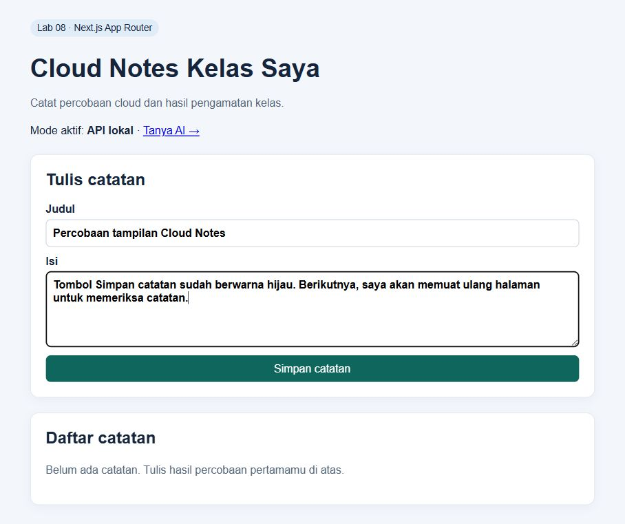

# Lab 08 — Cloud Notes dengan Next.js dan Docker Compose

**Kebijakan kelas:** Lab ini latihan formatif, tanpa tugas, nilai, atau penyerahan terpisah. Satu proyek besar dikerjakan oleh kelompok **3 orang**, dengan presentasi checkpoint minggu 7 (UTS) dan hasil akhir minggu 14 (UAS). Simpan hasil lab hanya bila berguna sebagai referensi atau bukti proses proyek. Baca [brief proyek kelompok](PROYEK_KELOMPOK.md). Bobot resmi tetap mengikuti RPS/LMS.

Satu stack menjalankan **Next.js, API Lab 06, PostgreSQL, dan Redis**. Pilih Docker di laptop atau GitHub Codespaces. Kedua jalur memakai perintah dan latihan yang sama. Browser mengakses Next.js di port 3000. Route Handler Next.js meneruskan GET dan POST ke API pada jaringan internal Docker.

## Mulai di sini

| Kalau kamu ingin… | Buka bagian ini |
|---|---|
| Menjalankan aplikasi untuk pertama kali | [Docker di laptop (jalur utama)](#a-docker-di-laptop) atau [GitHub Codespaces](#b-github-codespaces) |
| Mencoba alur simpan, memeriksa input, dan memulihkan API | [Latihan inti](#latihan-inti-untuk-kedua-jalur) dan [cek keamanan web](#cek-keamanan-web) |
| Menemukan berkas yang mengatur halaman, warna tombol, dan API | [Peta berkas](#peta-berkas) |
| **Mengubah tampilan web dan melihat hasilnya** | [Tutorial modifikasi halaman Cloud Notes](#modifikasi-halaman-cloud-notes) |
| Memakai server pengembangan Node.js | [Jalur manual dengan next dev](#jalur-manual-nodejs) |
| Menerbitkan versi latihan ke Vercel dengan data dari Supabase | [Pengayaan Supabase dan Vercel di modul mahasiswa](MODUL_MAHASISWA.md#tambahan-b-supabase-dan-vercel) |

Untuk kelas ini, buka [branch lab08-docker-codespaces](https://github.com/SeedFlora/meet8CloudService/tree/lab08-docker-codespaces). Jika ingin mencoba mengubah tampilan, teruskan ke tutorial modifikasi ketika aplikasi masih berjalan, sebelum langkah **Selesai latihan**.

## A. Docker di laptop

1. Buka Docker Desktop sampai engine siap. Image menyediakan Node.js, Python, PostgreSQL, dan Redis. Siapkan satu salinan repo ini melalui Git atau menu **Code → Download ZIP**, ekstrak, lalu buka PowerShell pada foldernya.
2. Untuk mengambil versi ini lewat Git, jalankan perintah berikut dari folder kerja pilihanmu.

   ```powershell
   git clone --branch lab08-docker-codespaces --single-branch https://github.com/SeedFlora/meet8CloudService.git
   cd meet8CloudService
   ```

3. Jalankan Compose. Perintah pertama menampilkan bagian `Server` jika Docker sudah siap. Build pertama perlu internet untuk mengambil image, source API Lab 06, dan paket aplikasi.

   ```powershell
   docker version
   docker compose up --build -d --wait
   docker compose ps
   ```

4. Buka [Cloud Notes di port 3000](http://127.0.0.1:3000). Cari tulisan **Mode aktif: API lokal**. Jika port 3000 sudah dipakai, set `$env:LAB08_PORT = '3002'` di PowerShell sebelum `docker compose up`, lalu gunakan port 3002 di browser.

## B. GitHub Codespaces

1. Buka halaman repo pada branch `lab08-docker-codespaces`. Pilih **Code → Codespaces → Create codespace on lab08-docker-codespaces** dan tunggu editor terbuka. GitHub menyediakan Docker melalui konfigurasi `.devcontainer` repo ini. Akses Codespaces mengikuti kuota atau pengaturan akun GitHub masing-masing.
2. Codespace baru menjalankan Compose otomatis saat persiapan pertama. Jika memakai Codespace yang pernah dihentikan atau stack sudah ditutup, buka **Terminal** dan jalankan dari root repo. `docker compose ps` membantu melihat apakah keempat layanan sudah siap.

   ```bash
   docker version
   docker compose up --build -d --wait
   docker compose ps
   ```

3. Pada tab **Ports**, cari **Cloud Notes** pada port **3000**. Pilih **Open in Browser** dan pertahankan visibilitas **Private**. Dari terminal Codespace, `http://127.0.0.1:3000` menunjuk ke server di Codespace.

   Jika 3000 belum muncul di daftar, pilih **Add Port**, masukkan `3000`, lalu pastikan visibilitasnya **Private**. [Panduan port GitHub Codespaces](https://docs.github.com/en/codespaces/developing-in-a-codespace/forwarding-ports-in-your-codespace)

## Latihan inti untuk kedua jalur

1. Isi judul dan isi catatan latihan di browser, klik **Simpan**, lalu refresh. Temukan kembali judul yang sama di daftar.
2. Tambahkan `/api/health` dan `/api/ready` ke URL aplikasi pada tab terpisah. Saat normal, keduanya mengembalikan HTTP **200**. `health` mengecek proses Next.js, sedangkan `ready` mengecek API Lab 06.
3. Jalankan checker dari root repo. Checker membuat satu catatan uji, memeriksa status GET dan POST, request ID, serta respons untuk input yang ditolak.

   ```text
   docker compose exec -T web npm run check:local
   ```

4. Simulasikan gangguan di stack latihanmu. Hentikan hanya service `api`, refresh Cloud Notes dan periksa lagi kedua endpoint. `health` tetap **200**, sementara `ready` dan `/api/notes` menjadi **503**. Nyalakan kembali API, lalu cek `ready` dan `/api/notes` kembali **200** serta catatan sebelumnya tetap muncul.

   ```text
   docker compose stop api
   docker compose up -d --wait api
   ```

   Jalankan baris kedua setelah selesai mengamati gangguan. Untuk melihat log Next.js, gunakan `docker compose logs --tail 30 web`.

### Cek keamanan web

- **Validasi di server.** Bandingkan catatan valid dengan judul kosong, JSON bertipe salah, atau judul melewati batas. Checker menunjukkan HTTP **400** untuk bentuk atau isi yang wajib diisi dan **422** untuk panjang yang melampaui batas. Next.js menolak request itu sebelum meneruskannya ke API Lab 06.
- **Batasi akses jaringan.** Pada `docker compose ps`, hanya `web` yang memiliki pemetaan port host dengan tanda `->`. API, PostgreSQL, dan Redis berada di jaringan internal Compose. Di Codespaces, cek bahwa port **Cloud Notes** berstatus **Private**.
- **Pisahkan data latihan dan konfigurasi.** Pakai catatan contoh. Untuk pengayaan Supabase, gunakan publishable key di browser dan pertahankan service-role key di server. Uji isolasi catatan antarpengguna melalui RLS dari Lab 07.

### Selesai latihan

Jalankan `docker compose down`. Volume database menyimpan catatan untuk sesi berikutnya. Jika memakai Codespaces, pilih **Stop codespace** setelah menutup latihan. [Cara menghentikan Codespace](https://docs.github.com/en/codespaces/developing-in-a-codespace/stopping-and-starting-a-codespace)

## Peta berkas

Mulai dari folder yang berisi `compose.yaml`. Klik nama berkas di tabel untuk melihat sumbernya di GitHub. Buat perubahan di salinan proyek yang kamu jalankan.

| Berkas | Apa yang akan kamu temukan |
|---|---|
| [src/app/page.tsx](src/app/page.tsx) | Judul halaman, kalimat pembuka, formulir, tombol Simpan, serta daftar catatan. |
| [src/app/globals.css](src/app/globals.css) | Warna dan jarak antarelemen, termasuk aturan `button`, `button:disabled`, dan `button.secondary`. |
| [src/app/layout.tsx](src/app/layout.tsx) | Judul pada tab browser di dalam `metadata.title` dan pemuatan CSS. |
| [src/app/api/notes/route.ts](src/app/api/notes/route.ts) | Route Handler Next.js untuk GET/POST, validasi masukan, serta penerusan catatan ke API. |
| [compose.yaml](compose.yaml) dan [Dockerfile](Dockerfile) | Empat layanan, pemetaan port, volume data, serta cara membangun image web dari kode proyek. |
| [tests/challenge.mjs](tests/challenge.mjs) | Dua belas pemeriksaan yang dijalankan lewat `npm run check:local`. |

## Modifikasi halaman Cloud Notes

Sesudah langkah ini, halaman akan berjudul **Cloud Notes Kelas Saya** dan tombolnya akan berbunyi **Simpan catatan** dengan latar hijau tua. Latihan ini memakai Docker yang sudah berjalan, baik di laptop maupun di dalam Codespace.

### 1. Buka proyek yang sedang berjalan

- **Docker lokal (Windows).** Buka File Explorer di folder hasil ekstraksi atau clone yang dipakai saat menjalankan Compose. Pastikan `compose.yaml` dan folder `src` terlihat. Di VS Code pilih **File → Open Folder…**, pilih folder tersebut, lalu **Select Folder**. Untuk mengetik perintah, gunakan PowerShell yang tadi dipakai menjalankan Compose.
- **Codespaces.** Kembali ke tab browser yang menampilkan editor GitHub Codespaces. Buka **Explorer** di kiri dan **Terminal** di panel bawah. Saat Codespace baru dibuat, tunggu proses `postCreateCommand` selesai, lalu gunakan terminal **bash** untuk perintah berikut. Tab yang membuka Cloud Notes lewat **Ports → 3000 → Open in Browser** dipakai untuk melihat hasil.

Di terminal folder proyek, ketik `docker compose ps`. Cari `web`, `api`, `db`, dan `cache` dengan status **healthy**. Jika sudah menutup stack, mulai lagi dari bagian A atau B. Pada halaman utama, simpan satu catatan dengan judul `Sebelum modifikasi` dan isi `Saya akan membangun ulang web.` Muat ulang halaman dan cari catatan itu. Kita akan mencarinya sekali lagi setelah tampilan berubah.

### 2. Ganti judul, penjelasan, dan teks tombol

Di Explorer editor, buka **src → app → page.tsx**. Tekan **Ctrl+F** untuk mencari teks pada kolom kiri. Tekan **Esc** untuk kembali ke editor, pilih **hanya teks yang ditemukan**, lalu ketik penggantinya. Pertahankan tag HTML dan ekspresi di sekitarnya.

| Cari | Ganti menjadi |
|---|---|
| `<h1>Cloud Notes</h1>` | `<h1>Cloud Notes Kelas Saya</h1>` |
| `Catatan kelas dengan dua jalur data: API Compose lokal atau Supabase Auth + RLS.` | `Catat percobaan cloud dan hasil pengamatan kelas.` |
| `<button disabled={busy}>Simpan</button>` | `<button disabled={busy}>Simpan catatan</button>` |
| `Belum ada catatan yang terlihat.` | `Belum ada catatan. Tulis hasil percobaan pertamamu di atas.` |

Tekan **Ctrl+S**. Pesan pada baris terakhir muncul di bagian **Daftar catatan** saat daftar kosong. Jika datamu sudah berisi catatan, kamu akan melihat daftar itu. Untuk menguji pesan baru secara terpisah, buka Codespace baru dari branch kelas, tunggu stack sehat, lalu terapkan edit langkah 2–4 di mesin itu. Lewati pembuatan catatan awal di mesin kedua dan lihat daftar sebelum menyimpan catatan atau menjalankan checker. Mesin pertama tetap menyimpan data latihanmu.

### 3. Ganti warna tombol dan nama tab

1. Buka **src → app → globals.css**. Cari `background: #1256a0` di aturan `button`. Ganti hanya bagian tersebut menjadi `background: #0f665c`. Pertahankan `color: white` dan properti lain pada baris itu. Tekan **Ctrl+S**. Tombol utama akan berwarna hijau tua dengan teks putih. Kombinasi ini memiliki rasio kontras sekitar 6,8:1 pada tombol aktif.
2. Buka **src → app → layout.tsx**. Di dalam objek `metadata`, ganti `title: 'Cloud Notes',` menjadi `title: 'Cloud Notes | Praktikum 08',`. Pertahankan koma sesudah tanda petik dan tekan **Ctrl+S**. Perubahan ini terlihat di **tab browser**. Judul besar di dalam halaman berasal dari `page.tsx`.

### 4. Bangun ulang web dan lihat hasilnya

Docker menjalankan hasil build Next.js dari image. Setelah menyimpan ketiga berkas, jalankan dua baris berikut **satu per satu** dari folder yang berisi `compose.yaml`. Gunakan terminal yang sama dengan langkah 1. Opsi `--no-deps` membatasi pembuatan ulang ke layanan web yang dipilih. API, PostgreSQL, dan Redis sudah hidup saat kamu memulai tutorial ini.

```text
docker compose up --build -d --wait --no-deps web
docker compose ps
```

Tunggu build selesai dan `web` kembali **healthy**. Di laptop, buka [Cloud Notes pada port bawaan](http://127.0.0.1:3000) atau port 3002 jika sebelumnya kamu memilih port itu. Di Codespaces, kembali ke tab aplikasi yang dibuka melalui port privat 3000. Tekan **Ctrl+Shift+R** di browser untuk memuat ulang halaman beserta CSS. Jika tab terlalu sempit untuk membaca namanya, arahkan pointer ke tab.



Cocokkan **judul halaman**, **kalimat pembuka**, **teks dan warna tombol**, serta **nama tab** dengan contoh yang kamu ketik. Lalu cari `Sebelum modifikasi` pada daftar untuk memastikan catatan masih ada setelah web dibangun ulang. Pakai tombol baru untuk menyimpan satu catatan lagi, misalnya `Sesudah modifikasi`, lalu tekan **Ctrl+R** dan pastikan kedua judul tetap terlihat.

### 5. Periksa fungsi dan keamanan web

```text
docker compose exec -T web npm run check:local
```

Cari ringkasan `challenge: 12 PASS, 0 FAIL`. Teks dan warna diperiksa lewat browser. Checker menguji jalur data dan respons server. Judul kosong serta JSON rusak menghasilkan HTTP 400, masukan yang melampaui batas 120/5.000 karakter menghasilkan 422, dan penyimpanan valid menghasilkan 201 serta header `X-Request-ID`. Checker menambah satu catatan berawalan `Lab08-check-`. Di Codespaces, pertahankan port 3000 **Private**. Pada mode API lokal ini, pengguna yang bisa mengakses aplikasi membaca daftar catatan demo yang sama.

### Jika hasilnya berbeda

| Yang kamu lihat | Yang perlu diperiksa |
|---|---|
| Perubahan belum muncul | Pastikan ketiga berkas sudah tersimpan di folder proyek yang sedang berjalan. Periksa hasil build dan status `web`, lalu tekan **Ctrl+Shift+R** pada tab aplikasi. Cocokkan port di browser dengan `docker compose ps`. |
| Build gagal setelah mengedit TSX | Baca nama berkas dan nomor baris pada **error pertama**. Cocokkan tanda petik, koma, kurung kurawal, dan tag penutup dengan contoh. Perbaiki, simpan, dan ulangi langkah 4. |
| Muncul 502 atau daftar catatan gagal dimuat | Periksa `docker compose ps -a` dan buka `/api/ready` dari alamat aplikasi. Jika ada layanan yang berhenti, jalankan `docker compose up -d --wait` dari folder proyek. Coba lagi ketika semua layanan healthy. |
| Pesan daftar kosong belum muncul | Pesan itu tampil saat jumlah catatan nol. Jika judul catatan terlihat di daftar, halaman sedang menampilkan data yang sudah ada. |

**Mengembalikan tampilan awal.** Balikkan hanya penggantian pada tabel di langkah 2. Kembalikan warna ke `#1256a0` dan judul tab ke `'Cloud Notes'`. Jika memakai Git atau Codespaces, cek dahulu perbedaan pada tiga berkas dengan perintah di bawah agar editmu yang lain tetap tersimpan. Jika memakai ZIP, gunakan tabel penggantian sebagai acuan. Simpan berkas, ulangi langkah 4, dan muat ulang browser. Database tetap memakai volume proyek yang sama.

```text
git diff -- src/app/page.tsx src/app/globals.css src/app/layout.tsx
```

**Menyimpan hasil ke GitHub sendiri (opsional).** Jika ingin membawa desain ke mesin lain, buat fork yang menyertakan branch `lab08-docker-codespaces` (di formulir fork, kosongkan pilihan menyalin hanya branch default jika perlu). Pilih branch kelas di fork milikmu sebelum clone atau membuka Codespace. Setelah mengedit, buka **Source Control**, tinjau perubahan pada `page.tsx`, `globals.css` dan `layout.tsx`, klik **+** untuk file yang ingin disimpan, lalu **Commit** dan **Sync Changes** atau **Publish Branch**. Buka branch itu di GitHub dan periksa perubahan file. Catatan dalam database tetap berada di volume Docker masing-masing.

Setelah selesai, ikuti [cara menutup stack dan Codespace](#selesai-latihan). Untuk mengubah judul, warna, dan isi panel Grafana, buka [latihan modifikasi Grafana dan simulator di Teori 10](https://github.com/SeedFlora/meet10CloudService/blob/main/ml-monitoring/README.md#modifikasi-tampilan).

## Jalur manual Node.js

Gunakan jalur ini saat ingin mengedit kode dengan `next dev`, memakai backend dari pertemuan sebelumnya, atau mengikuti [modul Windows lama](MODUL_MAHASISWA.md) dan [PDF](MODUL_MAHASISWA.pdf). Backend berjalan pada port 18006. Modul membagi backend, frontend, dan pemeriksaan ke tiga terminal.

### Terminal 1 — backend Lab 06

Buka PowerShell di folder tempat menyimpan proyek:

```powershell
git clone https://github.com/SeedFlora/meet6CloudService.git meet6CloudService-local
Set-Location .\meet6CloudService-local
Copy-Item .\.env.example .\.env
docker compose up --build -d --wait
docker compose ps
curl.exe -i http://127.0.0.1:18006/health
```

Gunakan clone Lab 06 yang sudah sehat dari pertemuan sebelumnya sebagai pengganti clone baru. Pada clone lama, pertahankan `.env` dan volume. Hasil health harus HTTP 200 dan menyebut PostgreSQL serta Redis.

### Terminal 2 — frontend Lab 08

Buka PowerShell baru di folder induk yang sama:

```powershell
git clone https://github.com/SeedFlora/meet8CloudService.git meet8CloudService-local
Set-Location .\meet8CloudService-local
node --version
npm --version
npm ci
Copy-Item .\.env.example .\.env.local
npm run dev
```

Node harus versi **22+**, sesuai seluruh dependensi proyek. Buka <http://localhost:3000>. Buat catatan dan cocokkan hasilnya dengan <http://127.0.0.1:18006/notes>. Biarkan terminal 2 menjalankan Next.js.

### Terminal 3 — pemeriksaan

Buka terminal pada folder `meet8CloudService-local`:

```powershell
curl.exe -i http://localhost:3000/api/health
curl.exe -i http://localhost:3000/api/ready
```

Keduanya HTTP 200. Health memeriksa Next.js; ready memeriksa API Lab 06. Ikuti modul untuk uji POST, validasi HTTP 400, pembahasan source, typecheck, dan build. Checker tambahan `npm run check:local` membuat satu catatan uji; bukan prasyarat praktik.

## Tambahan: proxy model AI tanpa GPU (`/api/ai`)

Route Handler `src/app/api/ai/route.ts` meneruskan prompt dari halaman **Tanya AI** (`/ai`) ke provider **OpenAI-compatible**. Untuk demo lokal, isi `AI_BASE_URL` dan `AI_MODEL` di `.env.local`, dengan `AI_API_KEY` hanya jika provider memerlukannya. Simpan key di server, tanpa prefix `NEXT_PUBLIC_`. Jalankan ulang Next.js di loopback dengan `npm run dev -- --hostname 127.0.0.1`.

| Provider | `AI_BASE_URL` | Catatan |
|---|---|---|
| Ollama lokal | `http://127.0.0.1:11434/v1` | gratis dan offline, `AI_API_KEY` dikosongkan; contoh `AI_MODEL=hf.co/bartowski/Qwen2.5-1.5B-Instruct-GGUF:Q4_K_M` |
| Hugging Face Inference Providers | `https://router.huggingface.co/v1` | token HF |
| Groq | `https://api.groq.com/openai/v1` | API key Groq |
| Google Gemini | `https://generativelanguage.googleapis.com/v1beta/openai` | API key Gemini |
| Cloudflare Workers AI | `https://api.cloudflare.com/client/v4/accounts/<ACCOUNT_ID>/ai/v1` | token Cloudflare dengan akses Workers AI |

Jika memakai Ollama, jalankan `ollama pull hf.co/bartowski/Qwen2.5-1.5B-Instruct-GGUF:Q4_K_M` sekali untuk mengunduh model (sekitar 986 MB), lalu pakai nama model yang sama pada `AI_MODEL`. Setelah model tersedia, demo Ollama dapat berjalan offline.

Uji setelah server Next.js di-restart (terminal 3):

```powershell
# Windows PowerShell
Invoke-RestMethod http://127.0.0.1:3000/api/ai -Method Post -ContentType "application/json" -Body '{"prompt":"Apa itu Docker?"}'
```

```bash
# macOS / Linux
curl -s -X POST http://127.0.0.1:3000/api/ai -H 'Content-Type: application/json' -d '{"prompt":"Apa itu Docker?"}'
```

```
node tests/ai-proxy.mjs     # sama di semua OS; harus 3 PASS
```

Kode status: `200` jawaban, `400` prompt kosong/JSON rusak, `502` provider menolak atau responsnya rusak, `503` konfigurasi AI belum aktif, `504` provider mati atau melewati `AI_TIMEOUT_MS`. Cocokkan `X-Request-ID` pada hasil di browser dengan log Next.js.

Endpoint demo tidak memiliki autentikasi dan dinonaktifkan pada build produksi secara bawaan, termasuk di Vercel. Jika ingin menguji build produksi di laptop, set `AI_ENABLE_IN_PRODUCTION=true` dan jalankan `npm run start -- --hostname 127.0.0.1`. Deployment Cloud Notes ke Vercel pada modul tetap bisa dijalankan dengan fitur AI dinonaktifkan.

> **⚠ SESUAIKAN DI DEVICE-MU**
> - **Kecepatan CPU:** cek `ollama run <model> --verbose` → *eval rate*. Di bawah 10 token/detik, isi `AI_TIMEOUT_MS=60000` atau `AI_MAX_TOKENS=150` di `.env.local`, lalu restart server (`.env.local` hanya dibaca saat server mulai).
> - **RAM 4 GB:** pakai `hf.co/bartowski/Llama-3.2-1B-Instruct-GGUF:Q4_K_M` (0,81 GB). `AI_MODEL` harus sama persis dengan output `ollama list`.
> - **Install Ollama:** Windows dan macOS memakai installer dari ollama.com/download (berjalan sebagai aplikasi tray/menu bar); Linux memakai skrip install resmi. Perintah `ollama` sama di semua OS.
> - **Port 3000 terpakai:** `npm run dev -- -p 3001`, lalu sebelum tes set `LAB08_BASE_URL` (PowerShell `$env:LAB08_BASE_URL="http://127.0.0.1:3001"`; macOS/Linux `LAB08_BASE_URL=http://127.0.0.1:3001 node tests/ai-proxy.mjs`).

## Materi pendamping

- [Teori Vercel dan Next.js](slides/Teori_Pertemuan_08.pptx)
- [Slide praktik lokal](slides/LAB08_Cloud_Notes_Nextjs_Bukti_Live.pptx)
- [Git opsional ke repo pribadi](PANDUAN_GIT.md)
- [Proyek kelompok](PROYEK_KELOMPOK.md)

Bagian tambahan modul menjelaskan Supabase dan Git deployment ke Vercel. `.env.local` berada pada root repo, `LOCAL_API_URL` hanya dipakai server, sedangkan `NEXT_PUBLIC_SUPABASE_*` terlihat di browser. Gunakan hanya URL dan publishable key pada `NEXT_PUBLIC_`; service role/secret key tidak boleh berada di sana. Restart server sesudah mengubah konfigurasi.
